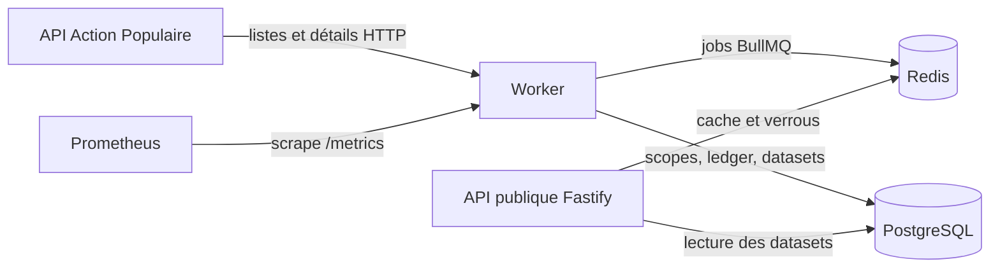
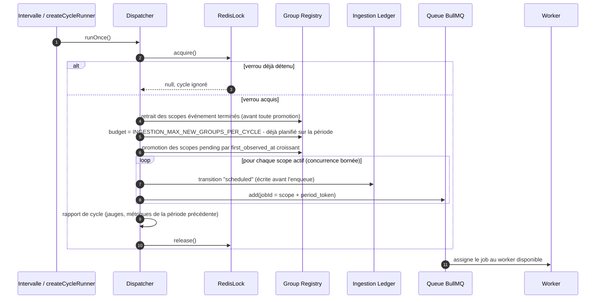

# Worker d'ingestion

Le worker est le seul composant qui parle à l'API Action Populaire. Il découvre les
groupes et événements, les récupère, les normalise et publie des snapshots lisibles que
l'API expose ensuite. Il ne sert aucune requête utilisateur : son cycle est périodique et
son état vit dans Redis (BullMQ) et dans PostgreSQL.

L'API et le worker sont déployables séparément mais partagent `packages/core`
(contrats, configuration, métriques). Les diagrammes détaillés existent déjà : voir
[`dispatcher.mmd`](dispatcher.mmd) pour le scheduling et [`worker.mmd`](worker.mmd) pour
le corps d'un job ; ce document décrit l'assemblage du runtime.

## Démarrage

1. `startWorker` (`runtime/lifecycle.ts`) charge le fichier d'environnement puis installe
   les filets `uncaughtException` et `unhandledRejection` (journalisés, jamais fatals).
2. `createWorkerRuntime(env)` (`runtime/runtime.ts`) résout la configuration via
   `@actionpop/core` : YAML `config/actionpop.yaml` puis surcharge par variables
   d'environnement. `UPSTREAM_BASE_URL` est obligatoire pour le worker.
3. `start()` exécute le contrôle préalable (`runtime/startup.ts`) : `probeRedis`, `checkPostgresHealth`,
   `checkPostgresSchema`. Un échec journalise les dépendances fautives et rejette le
   démarrage ; `startWorker` ferme alors le runtime pour ne pas laisser de handles ouverts.
4. `ensureMapScope` garantit l'existence du scope `map` quand la découverte est activée.
5. Le serveur HTTP de santé écoute sur `WORKER_HEALTH_PORT` (8081 par défaut).
6. `worker.waitUntilReady()` attend que BullMQ soit connecté, puis le premier cycle est
   lancé et un `setInterval` sans chevauchement le répète toutes les `queue.dispatcherIntervalMs`.
7. `SIGTERM` / `SIGINT` déclenchent `close()` une seule fois.

## Cycle d'orchestration

Un seul dispatcher travaille à la fois : le verrou distribué `RedisLock`
(`actionpop:lock:dispatcher`, TTL 60 s) est acquis avant toute écriture et libéré en
`finally`. Un cycle concurrent sort immédiatement.

Règles structurantes :

- **Retrait avant promotion.** Les ingestions événement dont `event_ends_at <= now` sont
  retirées en premier : un événement terminé n'est jamais promu ni planifié.
- **Budget par période.** Le plafond est partagé entre groupes découverts et ingestions
  événement, et déjà consommé sur la période : un redémarrage ne peut pas promouvoir un
  second lot complet. Le surplus attend le cycle suivant, il n'est pas perdu.
- **Déduplication double.** `isHandled(jobId)` consulte le ledger (statut terminal) et
  l'état BullMQ (`queueJobState`) : une ligne vivante ne compte que si la file détient
  encore le job. Sinon le job est remis en file.
- **Traçabilité avant enqueue.** La ligne `scheduled` est écrite avant `queue.add` : un
  worker peut terminer le job en quelques millisecondes et une écriture tardive
  écraserait son résultat. Le `jobId` (`buildIngestionJobId`) est stable pour un couple
  scope + période, donc un doublon ne crée pas de seconde entrée.
- **Rapport de cycle.** `reportDispatcherCycle` publie les jauges de registre et reprend
  la ligne `CycleMetrics` de la période précédente pour l'exploitant.

## Traitement des jobs

Le `Worker` BullMQ (`runtime/ingestion-worker.ts`) mappe chaque job sur
`processIngestionJob`, qui choisit le protocole selon `scope_kind` :

| `scope_kind` | Récupération                           | Effet                                       |
| ------------ | -------------------------------------- | ------------------------------------------- |
| `group`      | liste paginée des événements du groupe | publication des événements du groupe        |
| `event`      | détail d'un événement                  | publication/mise à jour du seul événement   |
| `map`        | liste publique de la carte             | observations et demande de scopes événement |

Le job porte `scopeId`, `scopeKind` et `periodStartUtc` ; un job antérieur sans
`scopeKind` est traité comme `group`. `attemptsMade` et `maxAttempts` sont transmis au
processeur, qui décide du retry (`classifyRetry`, `retryable`). Les options de file sont
`queue.attempts` tentatives avec backoff exponentiel `queue.backoffMs`, échecs conservés
(`removeOnFail: false`) et succès purgés après 24 h. Le ledger suit
`scheduled → running → publishing → succeeded | failed | retrying | stopped` ; toute
écriture est idempotente (hash de contenu, snapshot), un retry ne duplique rien.

## Cycle périodique annexe

Avant `dispatcher.runOnce()`, le cycle exécute trois étapes tolérantes aux pannes :

1. **Synchronisation du catalogue** (`catalogue-sync`) : un annuaire indisponible
   journalise `outcome: skipped` et laisse le cycle continuer.
2. **Rafraîchissement des rattachements géographiques** (`group-attachment`) : sans
   version active, l'étape est ignorée ; une erreur est capturée et journalisée, et les
   compteurs `actionpop_group_attachment_total{outcome}` sont incrémentés.
3. **Réconciliation du ledger** (`ingestion-ledger`) : seules les lignes vivantes non
   modifiées depuis `LEDGER_GRACE_MS` (1 h) sont comparées à l'état de la file, puis
   réparées en `succeeded`/`failed`.

## Observabilité

- Journaux structurés JSON via `createLogger({ service: 'worker' })`, toujours avec
  `operation` et `outcome` (`startup`, `dispatcher-cycle`, `catalogue-sync`,
  `group-attachment`, `ingestion-ledger`, `health`, `process`).
- `GET /metrics` (format Prometheus) expose l'état courant : jauges `actionpop_groups_active`,
  `pending`, `unlisted`, `stopped`, `unattached`, `actionpop_event_scopes_pending`,
  `active`, `retired`, `actionpop_map_observations`, `actionpop_events_without_territory`,
  `actionpop_queue_depth`, `actionpop_redis_ready`, et `actionpop_build_info{deployment,version}`.
- Compteurs cumulés : `actionpop_groups_scheduled_total`,
  `actionpop_event_ingestions_retired_total`, `actionpop_group_attachment_total`,
  `actionpop_geographic_refresh_total`.
- `GET /health/live` répond 200 sans dépendance ; `GET /health/ready` interroge Redis et
  PostgreSQL (délai 2 s) et répond 503 sinon.

## Modes de défaillance et garanties

- `createCycleRunner` absorbe toute exception : un cycle ne rejette jamais et ne
  chevauche jamais le précédent (le suivant est journalisé `reason: previous_cycle_running`).
- Un annuaire ou un référentiel spatial indisponible ne bloque pas le cycle.
- Un premier cycle en échec est retenté par l'intervalle ; il n'annule pas le démarrage.
- Une erreur de scrape ou de probe répond 503 et est journalisée, elle ne tue pas le
  processus.
- Arrêt gracieux dans l'ordre : intervalle, serveur HTTP, worker BullMQ, file, Redis,
  PostgreSQL.

## Carte du code

| Module                                           | Responsabilité                                                              |
| ------------------------------------------------ | --------------------------------------------------------------------------- |
| `runtime/types.ts`                               | types publics (`WorkerRuntime`, résumé de rafraîchissement, données de job) |
| `runtime/infrastructure.ts`                      | composition : config, connexions, dépôts, client, publisher, observabilité  |
| `runtime/ingestion-dependencies.ts`              | assemblage des dépendances d'ingestion (types, ledger, publisher, carte)    |
| `runtime/ingestion-worker.ts`                    | `Worker` BullMQ vers `processIngestionJob`                                  |
| `runtime/dispatcher.ts`                          | câblage du dispatcher (catalogue, verrou, budget, dedupe, rapport)          |
| `runtime/cycle.ts`                               | un cycle périodique complet (catalogue, rattachements, ledger, dispatch)    |
| `runtime/health.ts` / `runtime/health-server.ts` | sonde de readiness et serveur HTTP                                          |
| `runtime/operations.ts`                          | `syncObservedEventTypes`, `refreshGeographicReference`                      |
| `runtime/startup.ts`                             | contrôle préalable, écoute, attente BullMQ, intervalle, arrêt               |
| `runtime/runtime.ts`                             | façade `createWorkerRuntime(env)`                                           |
| `runtime/lifecycle.ts`                           | `startWorker`, signaux et filets de sécurité                                |
| `runtime/maintenance.ts`                         | `map:run` synchrone et plan/application du reset d'ingestion                |
| `runtime/queue-maintenance.ts`                   | découverte et retrait des jobs BullMQ à réinitialiser                       |
| `runtime/cli-args.ts` / `cli.ts`                 | analyse des commandes et point d'entrée du CLI opérateur                    |
| `main.ts`                                        | point d'entrée mince réexportant l'API publique                             |

## Configuration

Configuration résolue par `@actionpop/core` : YAML puis variables d'environnement.

| Clé                                     | Variable                                   | Rôle                                                            |
| --------------------------------------- | ------------------------------------------ | --------------------------------------------------------------- |
| `redis.url`                             | `REDIS_URL`                                | connexion Redis (BullMQ, verrou)                                |
| —                                       | `DATABASE_URL`                             | connexion PostgreSQL (obligatoire)                              |
| `upstream.baseUrl`                      | `UPSTREAM_BASE_URL`                        | base de l'API Action Populaire (obligatoire)                    |
| —                                       | `SOCK_PROXY`                               | proxy d'egress (`socks5://`, `socks://`, `http://`, `https://`) |
| —                                       | `WORKER_HEALTH_PORT`                       | port du serveur de santé (8081)                                 |
| —                                       | `APP_VERSION`                              | version exposée dans `actionpop_build_info`                     |
| `queue.attempts`                        | `QUEUE_ATTEMPTS`                           | tentatives par job                                              |
| `queue.backoffMs`                       | `QUEUE_BACKOFF_MS`                         | délai de backoff exponentiel                                    |
| `queue.dispatcherIntervalMs`            | `DISPATCHER_INTERVAL_MS`                   | période du cycle                                                |
| `ingestion.maxNewGroupsPerCycle`        | `INGESTION_MAX_NEW_GROUPS_PER_CYCLE`       | plafond de promotion par période                                |
| `ingestion.workerConcurrency`           | `INGESTION_WORKER_CONCURRENCY`             | jobs simultanés par worker                                      |
| `ingestion.mapDiscoveryEnabled`         | `INGESTION_MAP_DISCOVERY_ENABLED`          | active le scope `map`                                           |
| `ingestion.mapFreshnessHorizonMs`       | `INGESTION_MAP_FRESHNESS_HORIZON_MS`       | fraîcheur d'une observation                                     |
| `ingestion.mapReconciliationIntervalMs` | `INGESTION_MAP_RECONCILIATION_INTERVAL_MS` | délai de relecture d'un événement résolu                        |

Les valeurs par défaut et leur documentation vivent dans `config/actionpop.example.yaml`.

## Exploitation manuelle

Les commandes `map:run` et `reset` (ciblage groupes/événements/carte, dry-run par défaut)
sont décrites dans [worker-cli.md](worker-cli.md).
