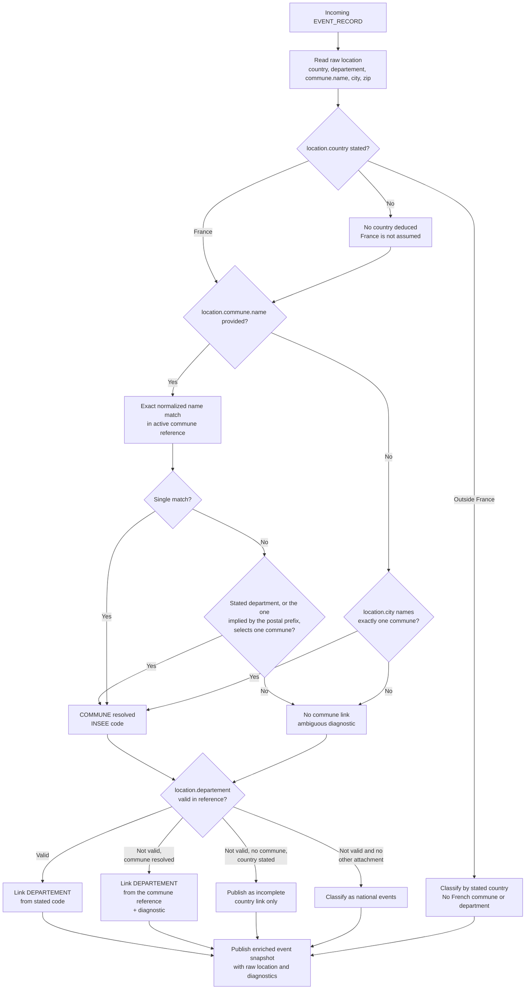

# Feature Specification: Geographic Enrichment and Event Filtering

**Feature Branch**: `002-geographic-enrichment`

**Created**: 2026-10-01

**Revised**: 2026-10-28

**Status**: Draft

**Input**: User description: "Add geographic data to the event calendar, model the French administrative geography, enrich events, support combined geographic filtering, validate event types, and update the geographic dataset from data.gouv.fr."

## Clarifications

### Session 2026-10-01

- Q: What should the system do when an event has no reliable geographic attachment? → A: Place it in a dedicated `national events` category.
- Q: How should updates to the local geographic dataset be triggered? → A: Manual refresh initiated by an operator.
- Q: Who should define the allowed event types? → A: Action Populaire's extensible event-type enum; platform additions or changes are accepted when the source enum is updated.
- Q: Should the geographic reference cover only France or also international events? → A: Cover France and international events; events outside France are classified by the country explicitly stated on the event.

### Session 2026-10-28 _(supersedes the 2026-10-02 clarifications)_

- Q: D'où viennent les données de rattachement géographique ? → A: Des champs bruts déjà fournis par le contrat Action Populaire (`location.country`, `location.departement`, `location.commune.name`, `location.city`, `location.zip`) ; aucun matching de coordonnées n'est nécessaire.
- Q: Quels niveaux administratifs cette version couvre-t-elle ? → A: Commune, département et pays uniquement ; la région, l'EPCI, la circonscription et l'arrondissement sont hors périmètre.
- Q: Comment la commune est-elle résolue ? → A: `location.commune.name` en priorité, sinon le nom de `location.city`. Le code postal ne sélectionne jamais une commune ; il ne sert qu'à lever une homonymie via son préfixe de département, de sorte qu'un code d'arrondissement (`75005`, `69003`, `13008`) rattache bien l'événement à Paris, Lyon ou Marseille.
- Q: Quel rôle joue `location.departement` ? → A: Le code fourni par la source est utilisé puis validé contre le référentiel ; un écart avec la commune résolue est diagnostiqué.
- Q: Quel est le format brut du département ? → A: Un code de département fourni en chaîne (`"69"`, `"2A"`), zéros initiaux conservés ; ce format est celui du contrat `action-populaire-events.md`.
- Q: Que faire lorsque `location.country` est absent ou vide ? → A: Aucun pays n'est déduit ; à défaut de tout rattachement utilisable, l'événement rejoint `national events`.
- Q: Que deviennent les coordonnées GPS ? → A: Elles sortent du périmètre de la spec ; aucune résolution spatiale n'est utilisée dans cette version.
- Q: Comment traiter les arrondissements municipaux (Paris, Lyon, Marseille) ? → A: Les modéliser est reporté ; `commune.name = "Paris 1er"` reste non résolu avec un diagnostic, alors que `city = "Paris"` rattache la commune `75056` quel que soit le code postal d'arrondissement.
- Q: Comment les formats de données sont-ils définis d'une étape à l'autre ? → A: Une section « Data Formats by Stage » fixe la représentation attendue à chaque étape (source, validation, référentiel, normalisation, enrichissement, publication, requête, diagnostic) et les conventions de valeur partagées.
- Q: Que faire d'un type d'événement que le registre local ne connaît pas encore ? → A: Le libellé bien formé est accepté et enregistré à sa première observation ; seul un libellé mal formé est rejeté, afin qu'une nouveauté côté plateforme ne casse jamais l'ingestion.
- Q: Que publier lorsqu'aucune version du référentiel géographique n'est active ? → A: L'événement est publié avec `geographic_status = unavailable` et conserve le pays déclaré, qui ne dépend d'aucune donnée de référence.

## User Scenarios & Testing _(mandatory)_

### User Story 1 - Publish geographically enriched events (Priority: P1)

As a calendar user, I want each event to keep its raw source location and to be linked to its country, department and commune when the source states them, so that I can understand where it takes place and use it in geographic searches.

**Why this priority**: The source event already carries the fields needed to attach an event to a country, a department and a commune; reliable attachment from those fields is the foundation for territorial filtering and requires no coordinate matching.

**Independent Test**: Ingest events whose `location` states a country, a department code and a commune name, then verify that the published event keeps its stable identity, its raw location and the expected country, department and commune links.

**Acceptance Scenarios**:

1. **Given** an event with `location.country = "FR"`, `location.departement = "69"` and `location.commune.name = "Lyon"`, **When** it is ingested, **Then** it is linked to France, to department `69` and to the commune whose INSEE code is `69123`.
2. **Given** an event whose `location.commune.name` matches several homonymous communes and whose `location.departement` is a valid code, **When** it is ingested, **Then** the commune of that department is selected.
3. **Given** an event without `location.commune.name` whose `location.city` names exactly one commune in the applicable department, **When** it is ingested, **Then** that commune is resolved, even when the stated postal code is an arrondissement code absent from the reference.
4. **Given** an event whose commune cannot be determined, **When** it is ingested, **Then** the event remains published with its raw location, keeps any department link it could establish, and exposes an incomplete-enrichment diagnostic.
5. **Given** an event whose `location.country` is outside France, **When** it is ingested, **Then** it is classified by that country without being assigned a French commune or department.
6. **Given** an event with neither a stated country, nor a department code, nor a commune name, **When** it is ingested, **Then** it is published in the `national events` category.

### User Story 2 - Filter events using intersecting geographic criteria (Priority: P1)

As a calendar user, I want to combine geographic and event-type criteria, such as a department, a commune and `tractage`, so that I receive only the events matching every selected criterion.

**Why this priority**: The core use case is a precise query such as "tractage events in department 69 and in Lyon".

**Independent Test**: Load events across several communes, departments and event types, apply two or more filters, and verify that only the intersection is returned.

**Acceptance Scenarios**:

1. **Given** events associated with several communes and departments, **When** the user filters by one department and one commune, **Then** only events associated with both are returned.
2. **Given** a geographic filter with no matching event, **When** the search is executed, **Then** the result is empty and does not include events from a neighboring area.
3. **Given** several optional filters, **When** only one filter is supplied, **Then** only that criterion is applied and all matching events remain eligible.
4. **Given** an event linked to several groups or geographic areas through link records, **When** a filter is applied, **Then** the event matches if the relevant link exists and is not duplicated in the result.

### User Story 3 - Update and validate the geographic reference dataset (Priority: P1)

As an operator, I want to refresh the versioned local commune dataset used for enrichment so that administrative relationships can be adopted or corrected without making the published event catalogue inconsistent.

**Why this priority**: Commune and department names and attachments change, so enrichment must be reproducible, attributable and updateable.

**Independent Test**: Submit a valid and an invalid dataset version, verify validation and diagnostics, activate the valid version atomically, and confirm that the previous version remains available until activation succeeds.

**Acceptance Scenarios**:

1. **Given** a new commune dataset with valid structure, identifiers, department relationships, provenance and license metadata, **When** the refresh is validated, **Then** it can become the active reference version.
2. **Given** a dataset with missing required entities, duplicate identifiers, invalid department references or insufficient coverage, **When** validation runs, **Then** activation is refused with a diagnostic and the current version remains active.
3. **Given** an active dataset version is replaced, **When** commune or department links change, **Then** affected events can be identified and re-enriched without changing their stable source identifiers.
4. **Given** a commune absent from the active reference, **When** an event referring to it is enriched, **Then** only the commune link is left unresolved and the country and department links that the source allows remain available.

### User Story 4 - Validate and diagnose incoming event geography and types (Priority: P2)

As an operator, I want incoming event locations and event types validated before publication so that invalid data is diagnosed with an actionable message while incomplete but usable events remain visible.

**Why this priority**: Search quality depends on strict validation of the source fields and clear operational diagnostics.

**Independent Test**: Submit valid, incomplete, and inconsistent payloads and verify validation decisions, retained raw fields, and reported diagnostics.

**Acceptance Scenarios**:

1. **Given** an event with an allowed type, valid dates and coherent geographic fields, **When** it is validated, **Then** it is accepted.
2. **Given** an event with a type absent from the current Action Populaire event-type enum, **When** it is validated, **Then** it is rejected with an error naming the affected field and cause.
3. **Given** an event whose `location.departement` code is unknown to the active reference, **When** it is ingested, **Then** the event is published without a department link derived from that code, a diagnostic names the field and value, and commune resolution is not blocked.
4. **Given** an event whose commune name matches several communes and whose department code is missing or unknown, **When** it is ingested, **Then** the event is published without a commune link and with an ambiguity diagnostic instead of an arbitrary choice.
5. **Given** an event with an unsupported `location.country` value, **When** it is ingested, **Then** no country is guessed, a diagnostic names the field and value, and the event remains published.

## Geographic Enrichment Flow



The stated country, department code and commune name are the only geographic inputs. A stated country outside France is authoritative and excludes all French administrative links. When the source states France, the commune is resolved from `location.commune.name` first and from the `location.city` name second; the postal code never selects a commune and only disambiguates through its department prefix, so an arrondissement code still attaches Paris, Lyon or Marseille; the stated department code is used independently, validated against the active reference, and any inconsistency with the resolved commune is diagnosed rather than silently corrected. Events with no usable geographic field are published in `national events`; map coordinates never participate in the decision.

The representation expected at each step of this flow is defined in [Data Formats by Stage](#data-formats-by-stage).

### Edge Cases

- Commune names may contain accents, apostrophes, hyphens or articles; comparison must normalize case, accents, punctuation and whitespace without changing the stored official name.
- Two communes with the same display name must remain distinguishable by their INSEE codes; only a validated department code may disambiguate them.
- Department and INSEE codes may contain leading zeroes and must remain strings; Corsican codes may be alphanumeric (`2A`, `2B`).
- A postal code may be a generic or arrondissement-level value absent from the reference (`75000` vs `75005`); it must never prevent a name-based match nor select a commune on its own.
- `location.city` may differ from the official commune name (spelling, article, former name); the fallback match is exact after normalization, never approximate, and a municipal arrondissement name such as `Paris 1er` stays unresolved until arrondissements are modelled.
- `location.commune.name` may be present while the commune is absent from the active reference; the event keeps its raw location and any department link, with an unresolved diagnostic.
- `location.country` may be absent, blank or unsupported; no country may be invented, and an unsupported value is diagnosed.
- The stated department code may disagree with the resolved commune's reference department; both raw values stay traceable.
- An event may have one raw location record and several group or administrative link records; the event must remain one event.
- An event with multiple group links must not be returned more than once by a search.
- A combined query must not change `AND` semantics to `OR` when one criterion has no match.
- An event type list must remain extensible without accepting malformed values; a newly published label is registered on first sight.
- Missing or outdated reference data must prevent only the affected attachment and must not delete valid raw event data.
- A failed dataset refresh must not expose a partially activated geographic reference.

## Data Formats by Stage

Geography passes through several representations. Each stage below is the only authority
for its own format, and no stage may emit a value the next stage cannot consume.

| #   | Stage                | Representation                              | Format rules                                                                                                                                                                                                                                                                                                               |
| --- | -------------------- | ------------------------------------------- | -------------------------------------------------------------------------------------------------------------------------------------------------------------------------------------------------------------------------------------------------------------------------------------------------------------------------- |
| 1   | Source retrieval     | Action Populaire event payload              | One event object for `/api/evenements/{eventId}/`, or a paginated JSON array of event objects for `/api/groupes/{groupId}/evenements/a-venir/?page=1&page_size=1000` (one-based pages, `page_size` capped at 1000; the `/passes/` endpoint follows the same pagination convention)                                         |
| 2   | Payload validation   | Validated event object                      | `startTime`, `endTime`, `timezone` validated as timezone-aware values; `location.country`, `location.departement`, `location.zip`, `location.city` and `location.commune.name` are strings or absent; an empty string means "not stated"; unknown fields are ignored and a malformed payload is rejected with a diagnostic |
| 3   | Geographic reference | Commune dataset published on `data.gouv.fr` | RFC 4180 CSV with a header row, UTF-8, quoted multi-value fields; identifiers and postal codes are read as strings, never as numbers                                                                                                                                                                                       |
| 4   | Normalization        | Comparison keys                             | Unicode NFC, case-folded, accents removed, punctuation and whitespace folded to one separator; country uppercased to ISO 3166-1 alpha-2; keys are derived values and never replace the raw ones                                                                                                                            |
| 5   | Enrichment           | Geographic attachment of one event          | `countryCode` (stated code, uppercase), `communeId` (INSEE code), `departmentCode`, `departmentSource` (`stated` or `reference`), `rawDepartmentCode` and `rawCommuneName` as stated, `geographicStatus` (`resolved`, `national`, `international`, `incomplete`, `invalid`, `unavailable`), `diagnostics[]`                |
| 6   | Publication          | Published event document                    | The enriched event with its location, group links and `referenceVersion`, published atomically; a reader observes either the previous or the new complete document                                                                                                                                                         |
| 7   | Filtering            | Query criteria                              | Query parameters `country`, `department`, `commune` and `event_type` as strings, using reference identifiers rather than display names                                                                                                                                                                                     |
| 8   | Diagnostics          | Problem report                              | `{ code, field, message, severity }` where `severity` is `warning` or `error` and `message` names the affected field and cause                                                                                                                                                                                             |

Value conventions shared by every stage:

- Codes are strings: department `"69"`, `"2A"`, INSEE `"01001"`, postal `"01400"`.
- Display names are stored exactly as their source states them; normalization only produces comparison keys.
- A field that is absent, `null` or an empty string means "not stated"; it is never replaced by a default value.
- No stage overwrites a raw source value; corrections appear as separate links and diagnostics.
- Geographic identifiers used in queries and responses are reference identifiers, never names and never coordinates.

The same event, at the source and after enrichment:

```json
{
  "location": {
    "country": "FR",
    "departement": "69",
    "zip": "69001",
    "city": "Lyon",
    "commune": { "name": "Lyon" }
  }
}
```

```json
{
  "countryCode": "FR",
  "departmentCode": "69",
  "departmentSource": "stated",
  "communeId": "69123",
  "rawDepartmentCode": "69",
  "rawCommuneName": "Lyon",
  "geographicStatus": "resolved",
  "diagnostics": []
}
```

## Requirements _(mandatory)_

### Functional Requirements

- **FR-001**: The system MUST represent an event location separately from the event record, with a stable location identifier and optional raw address fields.
- **FR-002**: A location record MUST support the event or group owner type, source name, primary and secondary address lines, postal code, city, full address, short address, and short location label.
- **FR-003**: The system MUST retain the country code stated on the event (`location.country`) as a string and MUST NOT deduce a country when that field is absent or blank.
- **FR-004**: The system MUST retain the department code stated on the event (`location.departement`) as a string, including leading zeroes and alphanumeric codes, and MUST treat it as a department code rather than a free-form department name.
- **FR-005**: The system MUST represent French departments and communes using stable administrative identifiers (department code, INSEE code), official names, and the commune-to-department relationship from the active reference, and MUST support country-level classification for events outside France.
- **FR-006**: The system MUST preserve the distinction between a commune, a department and a country even when their display names overlap.
- **FR-007**: The system MUST link an event to its country when the country is stated, MUST attempt commune and department links when that country is France, and MUST retain the raw location whatever the enrichment outcome.
- **FR-008**: The system MUST classify an event whose stated country is outside France by that country and MUST NOT assign it a French commune or department.
- **FR-009**: When the country is absent or blank, the system MUST deduce no country, MUST still attempt commune and department links from the stated source fields, and MUST classify the event in the `national events` category when no such link can be established.
- **FR-010**: The system MUST resolve the commune from `location.commune.name` first, using an exact match after normalization of case, accents, punctuation and whitespace against the official commune name or its pronoun-free alias in the active reference, and MUST NOT use fuzzy or approximate matching.
- **FR-011**: When no commune name is provided, the system MUST resolve the commune from `location.city` using the same exact normalized name rule, MUST use the stated department code or the department implied by the postal code prefix to disambiguate homonyms, and MUST NOT use the postal code itself to select a commune.
- **FR-012**: When a commune name matches several reference communes, the system MUST use the validated department code to disambiguate and MUST leave the commune unresolved with an actionable diagnostic when ambiguity remains or no department code is available.
- **FR-013**: The system MUST link the stated department code when it exists in the active reference, and MUST derive the department from the resolved commune's reference relationship, with a diagnostic, when the stated code is unknown and a commune is resolved.
- **FR-014**: When the stated department code disagrees with the department of the resolved commune, the system MUST preserve both raw values and expose a diagnostic naming the discrepancy.
- **FR-015**: The system MUST NOT assign region, EPCI, constituency or arrondissement references in this version and MUST NOT use map coordinates for any geographic attachment.
- **FR-016**: The system MUST represent event-to-group relationships through independently identifiable link records so that many-to-many coverage is preserved.
- **FR-017**: The system MUST preserve an event's stable source identifier, dates and event type when geographic enrichment or reference data changes.
- **FR-018**: The system MUST retain the event's source period and update metadata so that the latest successful observation can be identified.
- **FR-019**: The system MUST accept every well-formed event-type label the source publishes, register it on first observation, and reject only a malformed label with an actionable diagnostic naming `subtype.label`; a platform addition MUST NOT break ingestion.
- **FR-020**: The system MUST preserve administrative and postal codes as strings, including leading zeroes.
- **FR-021**: The system MUST allow filtering events by country, commune, department and event type when the relevant references are available.
- **FR-022**: The system MUST combine supplied filters with intersection semantics: an event MUST satisfy every supplied criterion.
- **FR-023**: The system MUST return zero results when no event satisfies all supplied criteria and MUST avoid duplicate events caused by multiple matching link records.
- **FR-024**: The system MUST distinguish missing, invalid, non-applicable, not-yet-enriched and reference-unavailable geographic data, and MUST place events without any reliable geographic attachment in the dedicated `national events` category.
- **FR-037**: When no geographic reference version is active, the system MUST still classify the event by its stated country and MUST publish it with an `unavailable` geographic status and an actionable diagnostic.
- **FR-025**: The system MUST publish an event with its location and geographic links atomically so that readers cannot observe a partially enriched event.
- **FR-026**: The system MUST support a versioned local French commune reference dataset populated from selected `data.gouv.fr` datasets.
- **FR-027**: The system MUST provide an explicit operator-triggered action to start a geographic dataset refresh and MUST not require an automatic refresh schedule for the first release.
- **FR-028**: Each geographic dataset version MUST retain its source, version identifier, publication date, ingestion date, and applicable license metadata.
- **FR-029**: The system MUST validate dataset structure, required identifiers, duplicate identifiers, department relationships and minimum coverage before activating a new version.
- **FR-030**: The system MUST keep the previous active dataset version available until the replacement has passed validation and has been atomically activated.
- **FR-031**: The system MUST identify events whose commune or department attachment changes after a dataset update and MUST support their reprocessing without changing their stable source identifiers.
- **FR-032**: The system MUST record ingestion job status, attempt count, current worker ownership, and the latest failure context for geographic refresh and event enrichment operations.
- **FR-033**: The system MUST record a processing ledger for each ingestion identity, including scheduled, running, publishing, succeeded, retrying, and failed outcomes.
- **FR-034**: The system MUST document the distribution and operating conditions of the selected search and storage solution before production use.
- **FR-035**: The system MUST isolate country classification, commune resolution, department validation, filtering and persistence boundaries so that each rule can be tested independently.
- **FR-036**: The system MUST keep the representation of geographic data explicit and stable at each stage, from the source payload through validation, reference data, normalization keys, enrichment result, published document and query criteria, and MUST NOT coerce codes to numbers or overwrite raw source values.

### Key Entities

- **Processing Period**: UTC processing slot with start and end timestamps used to identify an ingestion observation.
- **Group Scope**: Action Populaire group configuration and source metadata. Group geographic enrichment is outside this feature's first-release behavior, but its optional location reference remains compatible with the shared model.
- **Ingestion Job**: A deterministic scope-period operation with queue identity, status, attempt count, worker ownership, timestamps, and failure context.
- **Ingestion Ledger**: The durable processing identity and publication state for an ingestion job, including dispatch, completion, retry, and failure metadata.
- **Location Record**: A normalized event or group address record identified by `location_id`, with owner type, address presentation fields, postal code, city, and optional map URL. Raw country, department and commune-name values from the event source are retained.
- **Event Record**: The central published aggregate with source identity, content hash, sequence, status, dates, event type, timezone, summary, location reference, country, department and commune links, reference version, source URL, last-seen period, and update timestamp.
- **Event Type Enum**: The extensible Action Populaire-controlled set of valid event type values, including current values such as `tractage` and `boitage` and future platform additions.
- **Department**: French administrative area identified by its department code and name.
- **Commune**: Municipality identified by INSEE code, official name, postal codes and department reference.
- **Country**: Country stated on an event, used as the top-level classification for French and international events.
- **Event-Group Link**: Many-to-many link associating an event with one or more group scopes.
- **Geographic Reference Dataset**: Versioned local reference of French communes and departments, with provenance, coverage and license metadata sourced from selected `data.gouv.fr` datasets.

## Out of Scope (this version)

- Regions, EPCIs, legislative constituencies and municipal arrondissements are not modelled or populated; they are deferred to a later version, so an arrondissement name such as `Paris 1er` is diagnosed as unknown while `Paris` resolves.
- Coordinates are not used for any enrichment decision, and no point-in-polygon or spatial resolution is performed; existing coordinate storage is retained unchanged and must not be deleted by this feature.
- The constituency GeoJSON dataset is not part of this version's geographic reference.
- Fuzzy, phonetic or approximate name matching is excluded; only exact normalized matches are accepted.

## Success Criteria _(mandatory)_

### Measurable Outcomes

- **SC-001**: 100% of events stating France, a commune name resolvable to exactly one reference commune, and a valid department code are linked to that commune, its department and the country.
- **SC-002**: 100% of events rejected for a malformed event type produce a diagnostic naming the field and cause, while 100% of well-formed labels published by the source are accepted.
- **SC-003**: 100% of combined two-criterion geographic searches return only events satisfying both criteria in the reference test dataset.
- **SC-004**: At least 95% of usual geographic searches return a result within one second for the project's reference volume.
- **SC-005**: 100% of events remain retrievable by stable source identifier after a reference dataset update or geographic metadata change.
- **SC-006**: 100% of failed dataset refreshes leave the previously active reference version serving published results.
- **SC-007**: Operators can identify the proportion of events that are not enriched and distinguish absence, invalidity, non-applicability and unavailable-reference causes.
- **SC-008**: 100% of events whose stated country is outside France are classified by that country and are assigned no French administrative entity.
- **SC-009**: 100% of commune attachments use an exact match after normalization on `location.commune.name` or `location.city`, and ambiguous or unknown names remain visibly unresolved.
- **SC-010**: 100% of events with a usable department code but no resolvable commune keep the department link and expose the missing-commune diagnostic.
- **SC-011**: 100% of events without a stated country, department code or commune name are classified in `national events`.
- **SC-012**: 100% of department/commune disagreements expose a diagnostic retaining both raw values.
- **SC-013**: 100% of published geographic links trace back to a stated source field; no link depends on coordinates.
- **SC-014**: 100% of department, INSEE and postal codes remain strings with leading zeroes and alphanumeric codes preserved from ingestion to query.
- **SC-015**: 100% of published geographic values match the documented format of their stage; no raw source value is rewritten by enrichment.

## Assumptions

- The first release enriches and filters events only; groups are not geographically enriched by this feature.
- Events without a reliable geographic attachment are intentionally classified as `national events`; this category is a fallback classification, not a claim that the source event is geographically nationwide.
- The geographic attachment is derived exclusively from the Action Populaire event contract: `location.country`, `location.departement`, `location.commune.name`, `location.city` and `location.zip`.
- The active geographic reference is a versioned local dataset refreshed from selected `data.gouv.fr` publications after local validation and atomic activation.
- The first release refreshes the geographic reference only when an operator explicitly starts the refresh process; automatic scheduling is deferred.
- Administrative relationships are evaluated for a specific reference version and do not reconstruct historical boundary changes unless a future feature explicitly requires that.
- `location.country` is an ISO 3166-1 alpha-2 code as stated by the platform; an unknown or non-standard value is diagnosed and never guessed.
- `location.departement` is a department code, not a name, and is preserved verbatim.
- An INSEE code is not required as incoming event data; commune resolution relies on the stated commune name, or on the city name as a fallback.
- Event data and geographic data remain subject to their respective licenses; distribution must be checked for every selected source.
- Raw source location fields are retained alongside enriched references so events can be reprocessed without another event-source fetch.
- The project persists events and processing state in PostgreSQL through Prisma; the geographic reference lives in the same store so that activation and publication share one transactional boundary. The requirements themselves stay independent of that choice.
- Redis remains the job-queue transport only and holds no event or geographic data.
- The Action Populaire event-type enum is the source of truth and may evolve; local validation must follow its published additions and changes rather than use a permanently fixed list.
- The geographic scope is global: French events use the commune and department reference, while international events use the country explicitly stated on the event.

## Decisions

- **Geographic source**: The Action Populaire event contract already carries the country, department code, commune name, city and postal code, so attachment uses those stated fields. Coordinate matching, geocoding and spatial resolution are not needed and are excluded from this version.
- **Levels**: Only commune, department and country are represented and populated. Region, EPCI, constituency and arrondissement are deferred, and the constituency GeoJSON is not part of the reference for this version.
- **Commune precedence**: `location.commune.name` is authoritative when present; `location.city` is the fallback name source and must match exactly one commune after normalization. The reference CSV holds a single generic postal code for multi-postal communes (`69000`, `75000`, `13000`), so the postal code is never an equality criterion: it only disambiguates homonyms through its department prefix, which keeps `75005 Paris` attached to Paris.
- **Department handling**: The stated department code is used as the event's department link once validated against the active reference. An unknown code falls back to the resolved commune's reference department with a diagnostic, and a disagreement between the two values is preserved and diagnosed rather than silently resolved.
- **Country handling**: Only the stated country is used. A missing or blank country deduces nothing, so the event keeps any French commune or department attachment it could establish and otherwise falls back to `national events`.
- **Business boundaries**: Country classification, commune resolution, department validation, filtering and persistence are separate modules, each independently testable and within the project's 100–150-line maintainability target where practical.
- **Reference dataset**: The first version's reference is the local commune dataset (`data/communes-france-2026.csv`), validated, versioned and activated atomically with provenance and license metadata.
- **Persistence**: PostgreSQL through Prisma is the single store for reference versions and enriched events; a version is activated inside one database transaction guarded by a partial unique index, and Redis carries only queue state.
