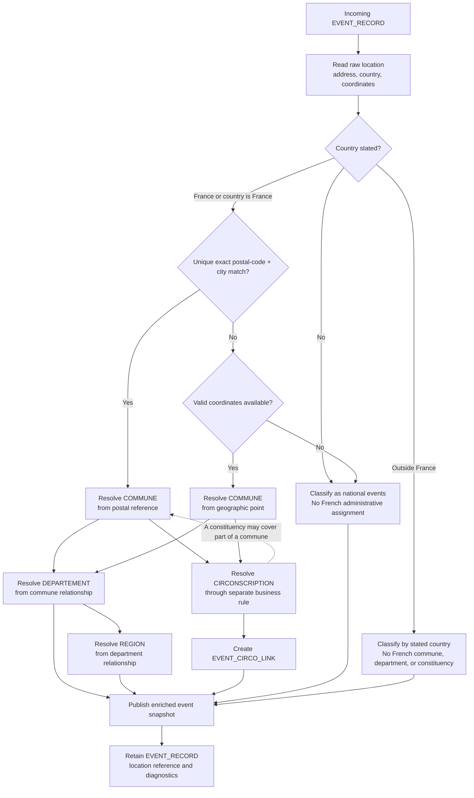

# Feature Specification: Geographic Enrichment and Event Filtering

**Feature Branch**: `002-geographic-enrichment`

**Created**: 2026-10-01

**Status**: Draft

**Input**: User description: "Add geographic data to the event calendar, model the French administrative geography, enrich events, support combined geographic filtering, validate event types, and update the geographic dataset from data.gouv.fr."

## Clarifications

### Session 2026-10-01

- Q: What should the system do when an event has no reliable geographic attachment? → A: Place it in a dedicated `national events` category.
- Q: How should updates to the local geographic dataset be triggered? → A: Manual refresh initiated by an operator.
- Q: Who should define the allowed event types? → A: Action Populaire's extensible event-type enum; platform additions or changes are accepted when the source enum is updated.
- Q: Should the geographic reference cover only France or also international events? → A: Cover France and international events; events outside France are classified by the country explicitly stated on the event.

### Session 2026-10-02

- Q: Lorsqu'un événement fournit uniquement un code postal et un nom de ville, quand faut-il l'associer à une commune ? → A: Option A, uniquement lorsqu'une correspondance postale unique et exacte est identifiée.
- Q: Lorsqu'une commune appartient à plusieurs circonscriptions et qu'aucune position précise ne permet de trancher, que doit faire l'enrichissement ? → A: Utiliser le GeoJSON pour les résolutions spatiales; sans position précise, laisser la circonscription non résolue.
- Q: Le code postal seul doit-il suffire pour rattacher un événement à une commune, ou faut-il aussi exiger le nom exact de la ville ? → A: Exiger le code postal et le nom exact de la ville; un code postal seul reste non résolu.
- Q: Lorsque le code postal + ville et les coordonnées GPS indiquent deux communes différentes, quelle donnée doit déterminer l'enrichissement communal ? → A: Le code postal + ville exact et unique est prioritaire; les coordonnées restent conservées comme données brutes et l'écart est diagnostiqué.
- Q: Lorsqu'un point GPS se trouve exactement sur la frontière entre deux circonscriptions du GeoJSON, que doit faire l'enrichissement ? → A: Attribuer toutes les circonscriptions qui touchent le point.

## User Scenarios & Testing *(mandatory)*

### User Story 1 - Publish geographically enriched events (Priority: P1)

As a calendar user, I want each event to retain its source location and be linked to the applicable French administrative areas so that I can understand where it takes place and use it in geographic searches.

**Why this priority**: Reliable geographic enrichment is the foundation for meaningful territorial filtering.

**Independent Test**: Ingest a valid event with coordinates or a reliable location identifier and verify that the published event retains its stable identity, raw location, and all applicable administrative references.

**Acceptance Scenarios**:

1. **Given** a valid event with a known location and geographic position, **When** it is ingested, **Then** it is associated with a commune and the applicable administrative levels above that commune.
2. **Given** a valid event whose position does not belong to an applicable optional geographic area, **When** it is ingested, **Then** applicable relationships are retained and non-applicable relationships remain absent without rejecting the event.
3. **Given** an event whose location cannot be reliably enriched, **When** it is ingested, **Then** the event remains available with its raw location and an identifiable incomplete-enrichment state.
4. **Given** an event with a location shared by multiple event records over time, **When** it is updated, **Then** the location reference remains stable unless the source owner changes.

### User Story 2 - Filter events using intersecting geographic criteria (Priority: P1)

As a calendar user, I want to combine several geographic and event-type criteria, such as a constituency, a commune, and `tractage`, so that I receive only the events matching every selected criterion.

**Why this priority**: The core use case is a precise query such as "tractage events in constituency 1 of Rhône and in Lyon".

**Independent Test**: Load events across several communes, departments, constituencies, and event types, apply two or more filters, and verify that only the intersection is returned.

**Acceptance Scenarios**:

1. **Given** events associated with multiple communes and constituencies, **When** the user filters by one constituency and one commune, **Then** only events associated with both are returned.
2. **Given** a geographic filter with no matching event, **When** the search is executed, **Then** the result is empty and does not include events from a neighboring area.
3. **Given** several optional filters, **When** only one filter is supplied, **Then** only that criterion is applied and all matching events remain eligible.
4. **Given** an event linked to several groups or geographic areas through link records, **When** a filter is applied, **Then** the event matches if the relevant link exists and is not duplicated in the result.

### User Story 3 - Update and validate the geographic reference dataset (Priority: P1)

As an operator, I want to refresh a versioned local geographic dataset from selected `data.gouv.fr` datasets so that new administrative relationships can be adopted without making the published event catalogue inconsistent.

**Why this priority**: Geographic boundaries and relationships change, so enrichment must be reproducible, attributable, and updateable.

**Independent Test**: Submit a valid and an invalid dataset version, verify validation and diagnostics, activate the valid version atomically, and confirm that the previous version remains available until activation succeeds.

**Acceptance Scenarios**:

1. **Given** a new dataset with valid structure, identifiers, relationships, provenance, and license metadata, **When** the refresh is validated, **Then** it can become the active reference version.
2. **Given** a dataset with missing required entities, duplicate identifiers, invalid relationships, or insufficient coverage, **When** validation runs, **Then** activation is refused with a diagnostic and the current version remains active.
3. **Given** an active dataset version is replaced, **When** event relationships change, **Then** affected events can be identified and re-enriched without changing their stable source identifiers.

### User Story 4 - Validate and diagnose incoming event geography (Priority: P2)

As an operator, I want incoming event locations and event types validated before publication so that invalid data is rejected with an actionable diagnostic while incomplete but usable locations remain visible.

**Why this priority**: Search quality depends on strict input validation and clear operational diagnostics.

**Independent Test**: Submit valid, incomplete, malformed, and out-of-range payloads and verify validation decisions, retained raw fields, and reported errors.

**Acceptance Scenarios**:

1. **Given** an event with an allowed type, valid dates, and coordinates within geographic bounds, **When** it is validated, **Then** it is accepted.
2. **Given** an event with out-of-range coordinates or a type absent from the current Action Populaire event-type enum, **When** it is validated, **Then** it is rejected with an error naming the affected field and cause.
3. **Given** an event without sufficient geographic data, **When** it is validated, **Then** it is published in the dedicated `national events` category and its incomplete geographic state is traceable.
4. **Given** an event outside France with a country explicitly stated on the event, **When** it is enriched, **Then** it is classified by that country without being assigned French administrative areas.

## Geographic Enrichment Flow

The exact unique postal match is authoritative when it conflicts with coordinates; the coordinates remain raw source data and the discrepancy is diagnosed. A commune determines its department and region through the geographic reference, while constituency membership is resolved separately because a constituency can cover several communes or only part of one. Events without a reliable French attachment are published as `national events`, and events outside France are classified by their stated country.

### Edge Cases

- A commune may belong to an EPCI while a constituency may cover several communes or only part of a major commune; relationships must not be reduced to an incorrect one-to-one model.
- An event may have one raw location record and several administrative link records; the event must remain one event.
- Coordinates received as longitude then latitude must not be interpreted as latitude then longitude.
- Null, absent, non-finite, or out-of-range coordinates must not produce silent false enrichment.
- Postal codes and administrative codes may contain leading zeroes and must remain strings.
- Two areas with the same display name must remain distinguishable by their official identifiers.
- An event with multiple group links must not be returned more than once by a search.
- A combined query must not change `AND` semantics to `OR` when one criterion has no match.
- An event type list must remain extensible without accepting undocumented arbitrary values.
- Missing or outdated reference data must prevent only the affected enrichment and must not delete valid raw event data.
- A failed dataset refresh must not expose a partially activated geographic reference.
- The supplied constituency GeoJSON is authoritative for spatial constituency resolution; without a precise position, no constituency is selected.
- When coordinates and an exact postal match disagree, the postal match determines the administrative enrichment; the coordinates remain available as raw data and the disagreement is diagnosable.
- When an event has no reliable geographic attachment, it remains published in the dedicated `national events` category and is not assigned to a specific administrative area.
- Event types are defined by an extensible Action Populaire enum; the local validation contract follows source enum additions and changes after the source catalogue is updated.
- A geographic reference dataset refresh is initiated manually by an operator; no automatic schedule is required for the first release.
- Events in France use the French administrative reference hierarchy; events outside France use the country explicitly stated on the event and are not forced into French administrative entities.
- A French commune may be resolved from an exact unique postal-code and city match; an INSEE code is not required as incoming event data, and an ambiguous or postal-code-only match is not silently accepted.
- A postal code alone is insufficient for commune resolution; the source must also provide the exact city name.
- When postal code + city and GPS disagree, the exact unique postal match determines the commune; GPS remains raw source data and the discrepancy is diagnosed.
- Constituency resolution is a separate business rule from commune and postal resolution, with independently testable logic and clear module boundaries.

## Requirements *(mandatory)*

### Functional Requirements

- **FR-001**: The system MUST represent an event location separately from the event record, with a stable location identifier and optional raw address fields.
- **FR-002**: A location record MUST support the event or group owner type, source name, primary and secondary address lines, postal code, city, full address, short address, and short location label.
- **FR-003**: The system MUST represent an optional geographic point as a GeoJSON-compatible point with finite longitude in `-180..180` and latitude in `-90..90`.
- **FR-004**: The system MUST represent French regions, departments, EPCI groupings, communes, and constituencies using stable administrative identifiers, names, applicable parent references, and constituency geometries from the supplied GeoJSON, and MUST support country-level classification for events outside France.
- **FR-005**: The system MUST preserve the distinction between a commune, an EPCI, a department, a region, and a constituency even when their display names overlap.
- **FR-006**: The system MUST associate an event with its commune when the location can be resolved and MUST retain the raw location when it cannot.
- **FR-007**: The system MUST classify an event outside France by the country explicitly stated on the event and MUST not assign it to French administrative areas.
- **FR-008**: When postal code + city and coordinates disagree, the system MUST use the exact unique postal match for administrative enrichment, retain the coordinates as raw source data, and expose the disagreement as a diagnostic state.
- **FR-009**: The system MUST represent event-to-group and event-to-constituency relationships through independently identifiable link records so that many-to-many coverage is preserved.
- **FR-010**: The system MUST preserve an event's stable source identifier, dates, and event type when geographic enrichment or reference data changes.
- **FR-011**: The system MUST retain the event's source period and update metadata so that the latest successful observation can be identified.
- **FR-012**: The system MUST validate event types against the current extensible Action Populaire event-type enum, accept newly published enum values after the source catalogue is updated, and reject values absent from that enum with an actionable diagnostic.
- **FR-013**: The system MUST preserve administrative codes and postal codes as strings, including leading zeroes.
- **FR-014**: The system MUST allow filtering events by country, commune, EPCI, department, region, constituency, and event type when the relevant references are available.
- **FR-015**: The system MUST combine supplied filters with intersection semantics: an event MUST satisfy every supplied criterion.
- **FR-016**: The system MUST return zero results when no event satisfies all supplied criteria and MUST avoid duplicate events caused by multiple matching link records.
- **FR-017**: The system MUST distinguish missing, invalid, non-applicable, and not-yet-enriched geographic data, and MUST place events without reliable geographic attachment in the dedicated `national events` category.
- **FR-018**: The system MUST publish an event and its location and geographic relationships atomically so that readers cannot observe a partially enriched event.
- **FR-019**: The system MUST support a versioned local French geographic reference dataset populated from selected `data.gouv.fr` datasets and a country-level reference for international events.
- **FR-020**: The system MUST provide an explicit operator-triggered action to start a geographic dataset refresh and MUST not require an automatic refresh schedule for the first release.
- **FR-021**: Each geographic dataset version MUST retain its source, version identifier, publication date, ingestion date, and applicable license metadata.
- **FR-022**: The system MUST validate dataset structure, required identifiers, parent relationships, link consistency, and minimum coverage before activating a new version.
- **FR-023**: The system MUST keep the previous active dataset version available until the replacement has passed validation and has been atomically activated.
- **FR-024**: The system MUST identify events whose enrichment changes after a dataset update and MUST support their reprocessing without changing their stable source identifiers.
- **FR-025**: The system MUST record ingestion job status, attempt count, current worker ownership, and the latest failure context for geographic refresh and event enrichment operations.
- **FR-026**: The system MUST record a processing ledger for each ingestion identity, including scheduled, running, publishing, succeeded, retrying, and failed outcomes.
- **FR-027**: The system MUST document the distribution and operating conditions of the selected search and storage solution before production use.
- **FR-028**: The system MUST isolate postal commune resolution, constituency resolution, geographic validation, filtering, and persistence boundaries so that each rule can be tested independently; constituency resolution MUST remain a separate business module.
- **FR-029**: The system MUST use the supplied constituency GeoJSON for point-in-polygon resolution when a precise position is available, MUST associate every constituency polygon that contains a boundary point, and MUST leave the constituency reference null with an actionable `constituency unresolved` diagnostic when no precise position is available for a multi-constituency commune.

### Key Entities

- **Processing Period**: UTC processing slot with start and end timestamps used to identify an ingestion observation.
- **Group Scope**: Action Populaire group configuration and source metadata. Group geographic enrichment is outside this feature's first-release behavior, but its optional location reference remains compatible with the shared model.
- **Ingestion Job**: A deterministic scope-period operation with queue identity, status, attempt count, worker ownership, timestamps, and failure context.
- **Ingestion Ledger**: The durable processing identity and publication state for an ingestion job, including dispatch, completion, retry, and failure metadata.
- **Location Record**: A normalized event or group address record identified by `location_id`, with owner type, address presentation fields, and optional map URL.
- **Geo Point**: Optional point geometry linked to a location record, represented as `Point` with longitude and latitude.
- **Event Record**: The central published aggregate with source identity, content hash, sequence, status, dates, event type, timezone, summary, location reference, source URL, last-seen period, and update timestamp.
- **Event Type Enum**: The extensible Action Populaire-controlled set of valid event type values, including current values such as `tractage` and `boitage` and future platform additions.
- **Region**: Top-level administrative area identified by region code and name.
- **Department**: Administrative area identified by department code and name, linked to a region.
- **EPCI**: Intermunicipal grouping identified by its identifier, name, and type.
- **Commune**: Municipality identified by INSEE code, name, postal code, EPCI reference, and department reference.
- **Country**: Country explicitly stated on an event for international classification when French administrative enrichment does not apply.
- **Constituency**: Electoral or political area identified by constituency identifier, number, name, department reference, and geometry from the supplied GeoJSON.
- **Event-Group Link**: Many-to-many link associating an event with one or more group scopes.
- **Event-Constituency Link**: Many-to-many link associating an event with one or more constituencies.
- **Geographic Reference Dataset**: Versioned local reference containing administrative entities, relationships, provenance, coverage, and license metadata sourced from selected `data.gouv.fr` datasets.

## Success Criteria *(mandatory)*

### Measurable Outcomes

- **SC-001**: At least 99% of events with valid coordinates and coverage in the active reference dataset are enriched with a commune and all applicable administrative levels.
- **SC-002**: 100% of events rejected for invalid geographic data or an unknown event type produce a diagnostic naming the field and cause.
- **SC-003**: 100% of combined two-criterion geographic searches return only events satisfying both criteria in the reference test dataset.
- **SC-004**: At least 95% of usual geographic searches return a result within one second for the project's reference volume.
- **SC-005**: 100% of events remain retrievable by stable source identifier after a reference dataset update or geographic metadata change.
- **SC-006**: 100% of failed dataset refreshes leave the previously active reference version serving published results.
- **SC-007**: Operators can identify the proportion of events that are not enriched and distinguish absence, invalidity, non-applicability, and unavailable-reference causes.
- **SC-008**: 100% of events outside France with a country stated on the event are classified by that country and are not assigned to a French administrative entity.
- **SC-009**: 100% of French events resolved from postal data use a unique exact postal-code and city match, while ambiguous matches remain visibly unresolved.
- **SC-010**: 100% of events in multi-constituency communes without a precise position remain without a constituency assignment and expose the unresolved diagnostic; boundary points retain every matching constituency link.
- **SC-011**: 100% of events with only a postal code and no city name remain without a commune assignment and expose the incomplete geographic diagnostic.
- **SC-012**: 100% of postal/GPS commune conflicts use the exact unique postal match for enrichment, retain the raw GPS point, and expose a discrepancy diagnostic.

## Assumptions

- The first release enriches and filters events only; groups are not geographically enriched by this feature.
- Events without a reliable geographic attachment are intentionally classified as `national events`; this category is a fallback classification, not a claim that the source event is geographically nationwide.
- The active geographic reference is a versioned local dataset refreshed from selected `data.gouv.fr` publications after local validation and atomic activation.
- The first release refreshes the geographic reference only when an operator explicitly starts the refresh process; automatic scheduling is deferred.
- Administrative relationships are evaluated for a specific reference version and do not reconstruct historical boundary changes unless a future feature explicitly requires that.
- A location without coordinates may be enriched from a reliable administrative identifier, but a city name alone is insufficient to silently choose between homonyms.
- Event data and geographic data remain subject to their respective licenses; distribution must be checked for every selected source.
- Raw source location fields are retained alongside enriched references so events can be reprocessed without another event-source fetch.
- A Redis-backed implementation may be used by the project, but the requirements do not make a particular storage engine part of the user-facing contract.
- The Action Populaire event-type enum is the source of truth and may evolve; local validation must follow its published additions and changes rather than use a permanently fixed list.
- The geographic scope is global: French events use the detailed French administrative hierarchy, while international events use the country explicitly stated on the event.

## Decisions

- **Geographic source**: Use a versioned local reference dataset updated from selected `data.gouv.fr` datasets. Preserve provenance, version, publication date, ingestion date, and license metadata for every active or retained version.
- **Business boundaries**: Resolve French communes from postal data independently from constituency enrichment. Keep each business module clear, independently testable, and within the project's 100-line maintainability target where practical.
