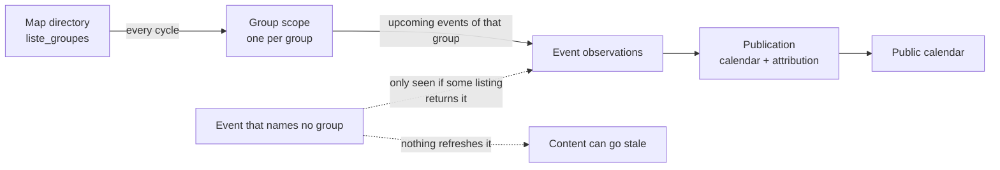
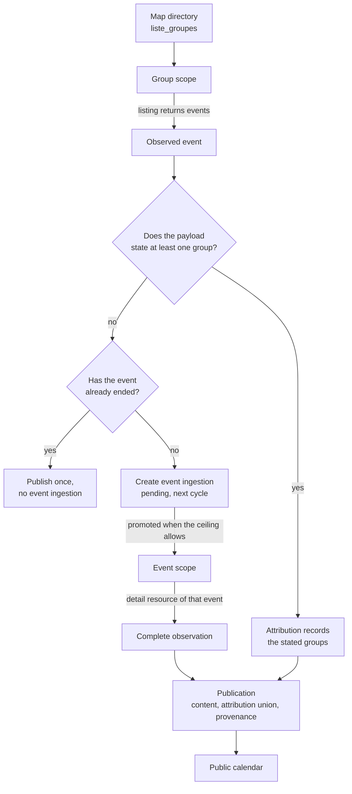
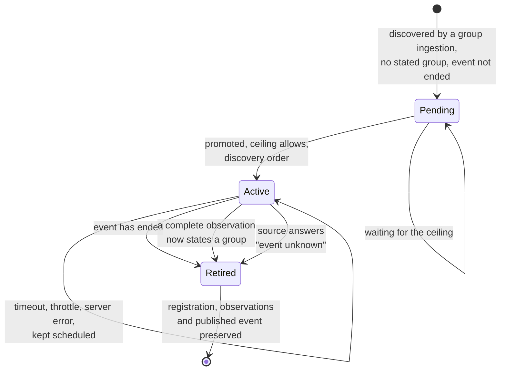
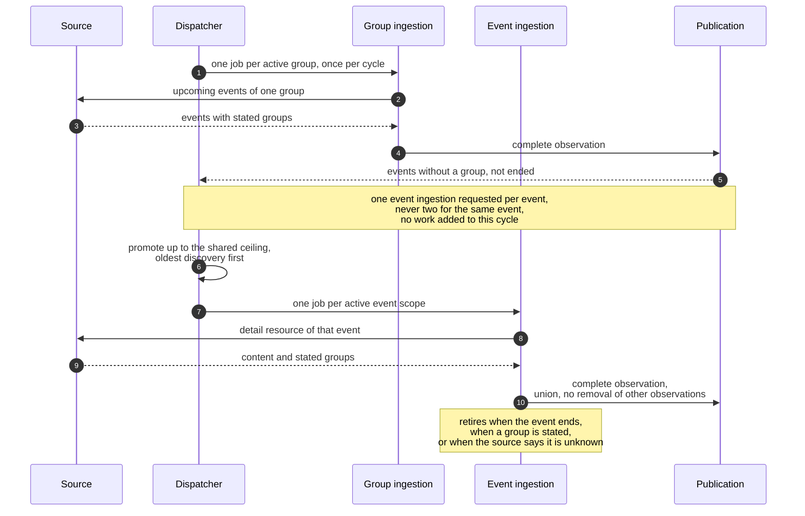
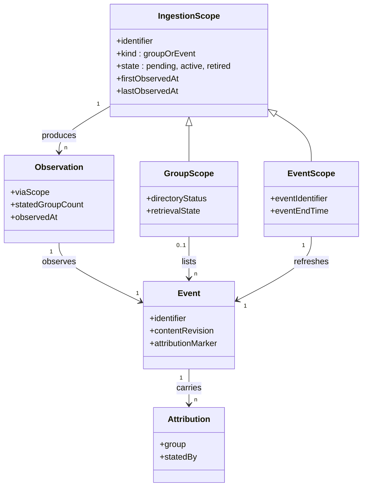

# Feature Specification: Dedicated Ingestion for Events Without a Stated Group

**Feature Branch**: `005-event-ingestion-scopes`

**Created**: 2026-10-29

**Status**: Draft

**Input**: User description: "Avoir une ingestion groupe ou ingestion événement — https://actionpopulaire.fr/api/evenements/777ed907-c8fa-4f3b-9209-9c73c6b7b23a/details/ — si découvert avec les ingestions de groupes, si événement n'a aucun groupe alors créer une ingestion spécifique pour mettre à jour cet événement. Faire un ensemble de schémas mermaid expliquant la démarche. Me poser des questions sur les choix de mise en place."

## Why This Feature Exists

The calendar currently has exactly one way of learning about an event: a group listing returns it. Every refresh, every correction and every discovery therefore depends on an organizer listing that happens to include the event.

The previous feature made the attribution reproduce what the source states, including an explicit "no group stated" marker. That fixed attribution, but not refresh: an event that states no group has no organizer listing to rely on. It stays published with whatever content the listing produced once, and nothing guarantees it is observed again — a moved, cancelled or rewritten event can keep showing stale information indefinitely.

The source already publishes a per-event detail resource (`/api/evenements/{id}/details/`), which returns everything a listing states about one event, plus the presentation fields a listing omits, in a single document with no pagination. The purpose of this feature is to give those events a first-class ingestion target of their own: the calendar learns an event through group ingestions and, when that event names no group and has not ended, creates a dedicated event ingestion that keeps it accurate until it finishes.

Two ingestion kinds therefore coexist: **group ingestion** (a listing of one group's upcoming events) and **event ingestion** (the detail resource of one event). Both observe, both publish and both feed attribution; only the group kind is a source of discovery and of organizer identity.

## Clarifications

### Session 2026-10-29

- Q: Which events get a dedicated event ingestion? → A: Only events whose payload states no group at all; an event that states at least one group keeps being refreshed by the listings that name it.
- Q: How long does an event ingestion stay scheduled? → A: Only while the event has not finished. It is never created for an event whose end time has already passed, and it stops once the event ends.
- Q: What authority does the detail resource have over attribution? → A: The same as any other complete observation: the groups it states join the union and never remove a link contributed by another observation. It is not a replacement.
- Q: How is an event ingestion represented? → A: As a distinct kind of ingestion scope alongside group scopes, sharing the scope registry with an explicit kind discriminator.
- Q: What ceiling applies to newly created event ingestions? → A: The same per-cycle ceiling and the same budget as newly discovered groups, with discovery order preserved and nothing discarded.
- Q: What happens when an event stops stating a group after its ingestion was retired? → A: It qualifies again: the same ingestion returns to the waiting state from the next dispatch cycle, still bounded by the shared ceiling, so a lost organizer never strands an event.

## Ingestion Flows (diagrams)

### Current state — a single ingestion kind

### Target state — two ingestion kinds, one decision point

### Event ingestion lifecycle

### One cycle, end to end

### Scope model

## User Scenarios & Testing *(mandatory)*

### User Story 1 - A group-less event stays accurate until it ends (Priority: P1)

As a calendar subscriber, I want an upcoming event that names no organizer to stay up to date — including a change of time, place, description or cancellation — so that I can trust what my calendar shows me even when no group is attached to the event.

**Why this priority**: This is the defect the feature exists for. Attribution already reports "no group stated"; without a dedicated refresh, that honest marker would sit on content that may be wrong forever.

**Independent Test**: Publish a listing whose event states no group and ends in the future, complete two cycles, change the event at the source between cycles, and verify the calendar reflects the change after the second cycle without any group listing returning that event.

**Acceptance Scenarios**:

1. **Given** a group listing returns an event that states no group and ends in the future, **When** the cycle completes, **Then** exactly one event ingestion exists for that event and it is not retrieved during that same cycle.
2. **Given** an event ingestion that has been promoted, **When** the source changes the event's time, place or description, **Then** the published event reflects the change after the next cycle.
3. **Given** an event ingestion whose event has ended, **When** the cycle completes, **Then** the event ingestion is no longer scheduled and the published event and its history remain available.
4. **Given** a group listing returns an event that states no group but has already ended, **When** the cycle completes, **Then** the event is published and no event ingestion is created.

---

### User Story 2 - Coverage grows bounded and without duplication (Priority: P1)

As a maintainer, I want every newly needed event ingestion to be created exactly once, on the next dispatch cycle, and within the same per-cycle ceiling as discovered groups, so that a listing full of group-less events cannot flood the queue or bypass the budget I configured.

**Why this priority**: The feature adds one retrieval per group-less event; without a shared budget and a one-cycle lag, a single large listing could multiply ingestion cost inside the cycle that discovered it.

**Independent Test**: Publish a listing with more group-less events than the configured ceiling allows, run cycles without new discoveries, and verify nothing is retrieved in the discovering cycle, that the ceiling of new ingestions is respected per cycle, and that every event is eventually ingested in discovery order.

**Acceptance Scenarios**:

1. **Given** several listings return the same group-less event in the same cycle, **When** the cycle completes, **Then** the event has exactly one event ingestion.
2. **Given** a listing discovers more group-less events than the ceiling allows, **When** cycles complete, **Then** exactly the ceiling number starts retrieval in the next cycle, the remainder keeps its discovery rank, and none is discarded.
3. **Given** discovered groups and group-less events compete for the same ceiling, **When** the next cycle runs, **Then** both are promoted in discovery order and the total promoted never exceeds the ceiling.
4. **Given** the same cycle is replayed with unchanged source data, **When** it completes, **Then** no additional event ingestion is created.

---

### User Story 3 - The two ingestion kinds never interfere (Priority: P2)

As a maintainer, I want an event ingestion to be unable to act as an organizer and to be untouched by the map directory, so that the group lifecycle and its reporting stay correct while events get refreshed.

**Why this priority**: Mixing the kinds would corrupt the group registry — count event ingestions as organizers, expose them in calendar group properties, or let a directory synchronization "remove" them.

**Independent Test**: After a directory synchronization and a detail ingestion run, verify that no event ingestion appears among organizers, that the directory synchronization changed no event ingestion's state, and that the calendar exposes no event ingestion as a group.

**Acceptance Scenarios**:

1. **Given** event ingestions exist, **When** the map directory is synchronized, **Then** no event ingestion is created, deactivated, removed or demoted by that synchronization.
2. **Given** an event attributed through a detail observation, **When** the calendar is read, **Then** the event carries only the groups the source states, never the event ingestion itself.
3. **Given** a detail observation states groups for an event already attributed by a listing, **When** it completes, **Then** the stated groups join the attribution and no link stated by another observation is removed.
4. **Given** an event ingestion is retired, **When** the group registry is counted, **Then** retired event ingestions are not counted as stopped groups.

---

### User Story 4 - Event ingestion activity is observable (Priority: P3)

As a maintainer, I want each cycle to report how many event ingestions were created, are waiting, are active, were retired, and how many detail readings failed, so that I can see whether group-less events are covered and detect regressions early.

**Why this priority**: Without measurement, the new cost and its coverage cannot be judged, and a silent retirement could hide a broken refresh path.

**Independent Test**: Run a cycle that discovers one group-less event, retires one ended event ingestion and fails one detail reading, then verify the reported counts match.

**Acceptance Scenarios**:

1. **Given** a completed cycle, **When** the maintainer reads operational reporting, **Then** it reports event ingestions created, waiting, active and retired, and failed detail readings.
2. **Given** a failed detail reading, **When** the cycle ends, **Then** no attribution, content or state change is reported for that event.
3. **Given** the same cycle is replayed with unchanged source data, **When** it completes, **Then** the reported creation, retirement and attribution changes are zero.

---

### Edge Cases

- Two different listings return the same group-less event during the same cycle.
- An event ends between its discovery and the promotion of its ingestion.
- An event ingestion is active when the event ends.
- The detail resource answers that the event is unknown, or the event has been deleted at the source.
- The detail resource returns a document whose identifier is not the requested event.
- The detail resource returns groups that contradict what a listing previously stated.
- An event that stated no group later states one while its event ingestion is active.
- An event whose ingestion was retired because it stated a group later stops stating one while still upcoming.
- An event states a group and no longer appears in any listing.
- A listing fails while another succeeds and discovers the same group-less events.
- The map directory is unavailable during a cycle where many event ingestions are active.
- A single listing returns a very large number of group-less events, far above the ceiling.
- A group-less event is discovered twice in the same cycle through pagination boundaries.
- An event ingestion is waiting for the ceiling when its event ends.
- An event's end time changes to a later date after its ingestion was created.

## Requirements *(mandatory)*

### Functional Requirements

- **FR-001**: A group ingestion that observes an event MUST detect that the event states no group and that its end time is still in the future, and MUST request exactly one dedicated event ingestion for that event — never in the cycle that discovered it, and never two for the same event.
- **FR-002**: An event ingestion MUST retrieve the source's per-event detail resource once per dispatch cycle while its event has not ended, and MUST NOT be retrieved more than once per cycle.
- **FR-003**: A successful detail retrieval MUST be treated as a complete observation of that event: it publishes the event's content, advances its revision when the content changes, and records the retrieval as provenance, exactly like a listing observation.
- **FR-004**: An event ingestion is a distinct kind of ingestion scope: it MUST NOT be an organizer, MUST NOT be attributed to any event, MUST NOT appear in the calendar as a group, and MUST NOT be synchronized, deactivated, removed or counted by the group directory.
- **FR-005**: Event ingestions MUST share the per-cycle promotion ceiling and budget with newly discovered groups. Groups and events compete in discovery order; the excess waits, is never discarded, and is scheduled in later cycles.
- **FR-006**: A detail observation MUST contribute its stated groups to the event's attribution union. It MUST NOT remove or replace a link contributed by another observation, and a complete detail observation that states no group MUST leave the event's attribution as it was.
- **FR-007**: An event ingestion MUST stop being scheduled, at most once per qualifying state, when the event's end time has passed, when a complete observation states at least one group for the event, or when the source explicitly answers that the event is unknown or does not exist. Retirement MUST NOT be terminal while the qualifying condition recurs: an event that later stops stating a group while still not ended returns its existing ingestion to the waiting state from the next dispatch cycle, without creating a second ingestion.
- **FR-008**: Retiring an event ingestion MUST preserve the event, its published content, its attributions, its observations and its history, and MUST be reported to operators.
- **FR-009**: A timeout, throttling answer, unreadable payload, identifier mismatch with the requested event, or server error MUST leave the event ingestion scheduled and retryable, and MUST NOT publish, change content, change attribution or change the ingestion's state.
- **FR-010**: An event ingestion MUST be identified by the event's source identifier, so that repeated discovery across listings and cycles never creates a second ingestion for the same event.
- **FR-011**: Each cycle MUST report, through operational reporting, the number of event ingestions created, waiting for promotion, active, retired and failed, alongside the existing group and attribution counters.
- **FR-012**: The public calendar contract MUST remain unchanged: no new endpoint, no new or removed property, and each event still appears exactly once.
- **FR-013**: An event that names no group, has already ended and is observed by a group ingestion MUST still be published and marked as stating no group; only the dedicated ingestion is omitted.
- **FR-014**: Creating or retiring an event ingestion MUST NOT modify the directory status or retrieval state of any group, and MUST NOT change which groups are retrieved.

### Key Entities *(include if data involved)*

- **Ingestion scope**: a unit the dispatcher retrieves at most once per cycle. It has a kind — group or event — an identifier, a lifecycle state, and the moments it was first and last observed.
- **Event ingestion**: the activity of observing one event through the source's detail resource. It is carried by exactly one **event scope** — the stored unit the dispatcher retrieves at most once per cycle, from the moment a group ingestion discovers it until it ends, gains a group, or is reported unknown — and an event scope is never an organizer.
- **Event**: the published calendar entry, identified by its source identifier, with its content revision, timing, location, the groups it is attributed to and its "no group stated" marker.
- **Observation**: one complete retrieval that establishes both content and the groups the source states, attributed to the scope that produced it.
- **Attribution**: the link between an event and a group, established by any complete observation, unioned across observations and never replaced by a later one.
- **Cycle report**: the per-cycle counts of event ingestions created, waiting, active, retired and failed, next to the existing group and attribution counters.

## Success Criteria *(mandatory)*

### Measurable Outcomes

- **SC-001**: 100% of events whose payload states no group and whose end time is in the future have exactly one dedicated ingestion, and 0% of events that state a group have one.
- **SC-002**: For 100% of group-less events that are still upcoming, a change made at the source is visible in the calendar within one cycle, with no group listing returning that event.
- **SC-003**: A detail observation removes zero attributions: replaying an unchanged source reports zero added and zero removed attributions for those events.
- **SC-004**: Discovery is idempotent: replaying an unchanged cycle creates zero additional event ingestions and retires zero ingestions.
- **SC-005**: New ingestions never exceed the configured per-cycle ceiling: exactly the ceiling starts retrieval when the backlog exceeds it, every remaining item keeps its discovery rank, and 100% are scheduled within a number of cycles equal to its rank divided by the ceiling, rounded up.
- **SC-006**: An ended event's ingestion performs zero further retrievals after the cycle in which the event ended, while its history remains available.
- **SC-007**: An event the source reports unknown stops with zero further retrievals, while an event whose readings fail for any other reason keeps exactly one retrieval per cycle and is never retired.
- **SC-008**: A complete map directory synchronization changes the state of zero event ingestions.
- **SC-009**: Calendar consumers see no change in the set of properties per entry, and every event still appears exactly once.
- **SC-010**: A maintainer can obtain, for the last completed cycle, the counts of event ingestions created, waiting, active, retired and failed without reading raw event data, in under one minute.

## Assumptions

- The per-event detail resource is authoritative for that event's content, returns a single document with no pagination, states the same group identifiers as listings, and is safe to read once per cycle per event.
- Only events that state no group need a dedicated ingestion: an event that states at least one group is re-observed every cycle by the listings that name it, which is the existing and intended coverage.
- "Not finished" means the event's end time is still in the future in the canonical project timezone; an event whose end time passes while its ingestion is waiting is retired without ever being retrieved.
- An event ingestion is one retrieval per cycle, so the ingestion cost grows with the number of upcoming group-less events; the shared ceiling bounds that growth to the configured number of new ingestions per cycle.
- The shared ceiling keeps its current default of 200 new ingestions per cycle and remains configurable through deployment configuration.
- A detail observation records the event ingestion as its provenance, which is what makes coverage and traceability explainable without turning the ingestion into an organizer.
- Retirement is a state of the ingestion scope, not a deletion: no event, attribution, observation or snapshot is removed by this feature.
- An event that gains a group after its ingestion was created is henceforth re-observed by group listings; its ingestion is retired rather than kept as a parallel refresh path, and re-opened — never duplicated — if the event later stops stating a group while still upcoming.
- The calendar's existing retention rules for past events are unchanged; this feature neither shortens nor extends them.
- Illustration, subscription, RSVP, distance and other presentation fields of the detail resource are out of scope: only the content already published by the calendar is maintained.
- A map-wide event list is out of scope; discovery still starts from the map directory and from group listings.
- Subscriptions and per-user views are out of scope; they benefit from fresher content but are not modified.
