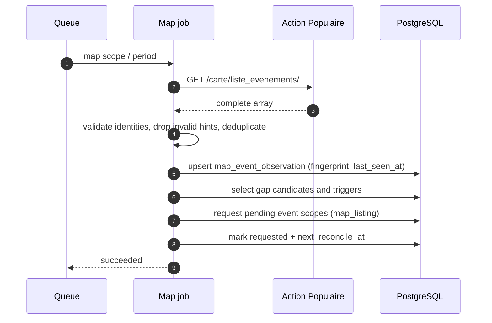

# Contract: Map Discovery Job and Selection

## Scheduling

The map discovery runs as a singleton ingestion scope:

| Property     | Value                                                                                   |
| ------------ | --------------------------------------------------------------------------------------- |
| `scope_id`   | `map-discovery`                                                                         |
| `scope_key`  | `map-discovery`                                                                         |
| `scope_kind` | `map`                                                                                   |
| Job identity | Existing `buildIngestionJobId('map-discovery', periodStartUtc)`                         |
| Frequency    | Once per processing period, like every active scope                                     |
| Concurrency  | One map job per period; the dispatcher deduplicates through the ledger and queue job id |

The map job is not a detail reader and not a publisher. It performs exactly one listing read, validation, observation writes and pending event-scope requests.

## Processing order

1. Mark the ledger `running`.
2. Read the listing through the client.
3. Validate and deduplicate summaries.
4. Upsert observations in batches of at most 500 identities; a fingerprint change clears `next_reconcile_at`.
5. Select gap candidates and triggers with one bounded query per batch.
6. Request pending event scopes through `requestEventScopes` with `discovery_source = 'map_listing'`.
7. Mark `last_requested_at`, `last_outcome = 'requested'` and `next_reconcile_at`.
8. Emit counters and logs, then mark the ledger `succeeded`.

The job never calls `fetchEventDetails` and never writes an event, snapshot, attribution or calendar property.

## Gap selection

An identity is a gap candidate when all of the following hold:

1. It appeared in the current complete listing.
2. No `event_observation` for it was recorded within `mapFreshnessHorizonMs` through a scope whose `retrieval_status` is still `active`.
3. No event scope for it is `pending` or `active`.
4. Its valid `end_time` is absent or after the current instant.

A gap candidate triggers a detail request when any of the following holds:

- `last_requested_at IS NULL` (never requested).
- `next_reconcile_at IS NULL` (new or summary changed).
- `next_reconcile_at <= now` (reconciliation due).
- `last_outcome = 'failed'` or `last_outcome = 'mismatched'` (previous attempt failed).

`next_reconcile_at` is set to `now + mapReconciliationIntervalMs` when requested.

## Scope request

- The existing event scope processor performs the detail read.
- New scopes start `pending`, so the map cycle adds no detail work to itself.
- The existing `maxNewGroupsPerCycle` budget promotes them in later cycles.
- A retired event scope is reopened on the same row, never duplicated.
- An absent end-time hint produces `event_ends_at = NULL`; a later detail observation writes the authoritative end time. Updates preserve an existing value with `COALESCE`.

## Outcomes

| Event processor outcome             | Map observation write                                                     |
| ----------------------------------- | ------------------------------------------------------------------------- |
| Publication succeeded               | `last_outcome = 'resolved'`, `next_reconcile_at = now + reconciliation`   |
| Detail answered 404                 | `last_outcome = 'unknown'`, `next_reconcile_at = now + reconciliation`    |
| Detail answered another identity    | `last_outcome = 'mismatched'`, `next_reconcile_at = now + reconciliation` |
| Job failed (retryable or exhausted) | `last_outcome = 'failed'`, `next_reconcile_at = now`                      |

Outcome writes are skipped when no `map_event_observation` row exists, which preserves the existing behaviour of group-less events discovered through group listings.

## Failure behaviour

| Failure                                   | Behaviour                                                                                           |
| ----------------------------------------- | --------------------------------------------------------------------------------------------------- |
| Listing `429`                             | Client retries in place; if the budget is spent, the job fails through the existing retry policy    |
| Listing timeout/network/`5xx`             | Job fails and is retried; observations and scopes are unchanged                                     |
| Listing non-array or invalid JSON         | `PayloadValidationError`, non-retryable; observations and scopes are unchanged                      |
| Database failure during upsert/select     | Job fails and is retried; no partial scope request is committed if the batch transaction rolls back |
| One invalid entry                         | Rejected or hint-dropped; the rest of the batch proceeds                                            |
| One invalid hint                          | Dropped and counted; the identity remains discoverable                                              |
| Feature disabled while a job is in flight | Processor stops before reading the listing; no observation or scope is written                      |

## Observability

Cycle metrics:

- `map.entries` — listing entries read (`read`).
- `map.rejected` — entries without a usable identity (`rejected`).
- `map.duplicates` — repeated identities collapsed.
- `map.hints_dropped` — invalid optional hints dropped.
- `map.gap_candidates` — gap candidates after coverage, schedule and end-time filters (`gap candidate`).
- `map.selected` — pending event scopes requested (`selected`).
- `map.skipped` — gap candidates not selected because reconciliation was not due (`skipped`).
- `map.outcomes_resolved` / `map.outcomes_unknown` / `map.outcomes_mismatched` / `map.outcomes_failed` — detail outcomes recorded later.

These counters cover listing entries and detail attempts requested by map discovery only. Detail attempts of event scopes discovered through group listings keep their existing event-ingestion counters.

Cumulative metrics:

- `actionpop_map_listing_entries_total`
- `actionpop_map_listing_rejected_total`
- `actionpop_map_hints_dropped_total`
- `actionpop_map_detail_requests_total`
- `actionpop_map_outcomes_total{outcome=...}` with `outcome` in `resolved`, `unknown`, `mismatched`, `failed`

Logs: one structured `map-discovery` completion line with duration, the counters above and the number of created/reopened event scopes.

## Compatibility guarantees

- Existing group catalogue, group event pagination, attribution, content hash, sequencing, retirement and calendar output are unchanged.
- The map summary never produces canonical content.
- Absence from the listing never cancels, removes or retires anything.
- The public HTTP API is unchanged.
