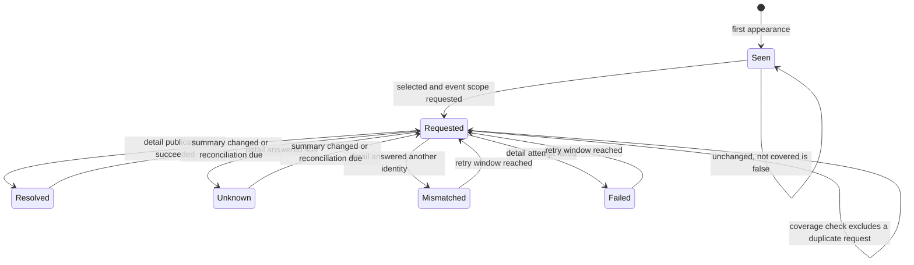

# Data Model: Map Event Discovery and Detail Resolution

## Entity overview

| Entity            | Purpose                                                                                  | Persistence                                        |
| ----------------- | ---------------------------------------------------------------------------------------- | -------------------------------------------------- |
| Map event summary | Validated listing entry: identity plus optional hints                                    | In memory for the job, never published             |
| Map observation   | Per-identity discovery ledger: fingerprint, visibility, request and reconciliation state | `map_event_observation`                            |
| Map scope         | Singleton scheduling target for the discovery job                                        | `ingestion_scope` row with `scope_kind = 'map'`    |
| Event scope       | Existing pending/active/retired detail ingestion created for selected identities         | `ingestion_scope` rows with `scope_kind = 'event'` |
| Canonical event   | Existing published representation, produced only from a detail document                  | Existing event tables, unchanged                   |

## Map event summary (in memory)

Validated from one array entry of `GET /carte/liste_evenements/`.

| Field         | Type                                                      | Rule                                                                                                         |
| ------------- | --------------------------------------------------------- | ------------------------------------------------------------------------------------------------------------ |
| `id`          | string                                                    | Mandatory, trimmed, non-empty. The only field whose absence rejects the entry                                |
| `name`        | string \| undefined                                       | Optional hint; trimmed, non-empty when present                                                               |
| `coordinates` | `{ type: 'Point', coordinates: [lon, lat] }` \| undefined | Optional hint; longitude `-180..180`, latitude `-90..90`; `null` becomes undefined                           |
| `date`        | string \| undefined                                       | Optional hint; never parsed                                                                                  |
| `link`        | string \| undefined                                       | Optional hint; absolute URL when present                                                                     |
| `start_time`  | string \| undefined                                       | Optional hint; ISO 8601 with explicit offset when present                                                    |
| `end_time`    | string \| undefined                                       | Optional hint; ISO 8601 with explicit offset when present; must not precede `start_time` when both are valid |
| `subtype`     | integer \| undefined                                      | Optional hint; integer when present                                                                          |

Validation returns:

- `summaries`: accepted summaries, one per identity after deduplication.
- `rejected`: count of entries without a usable identity.
- `droppedHints`: counts per field (`name`, `coordinates`, `date`, `link`, `start_time`, `end_time`, `subtype`).
- `duplicates`: count of identities that appeared more than once.

Non-array responses and invalid JSON are a `PayloadValidationError`, never an empty result.

## Map observation (`map_event_observation`)

| Column                | Type        | Null | Default | Meaning                                                            |
| --------------------- | ----------- | ---- | ------- | ------------------------------------------------------------------ |
| `event_id`            | text        | no   | —       | Primary key; the source event identity                             |
| `summary_fingerprint` | text        | no   | —       | Hash of name, start, end, coordinates and subtype                  |
| `display_name`        | text        | yes  | `null`  | Last valid name hint, for logs and promotion ordering display      |
| `start_time`          | timestamptz | yes  | `null`  | Last valid start hint                                              |
| `end_time`            | timestamptz | yes  | `null`  | Last valid end hint; used to avoid requesting ended events         |
| `subtype_id`          | integer     | yes  | `null`  | Last valid subtype hint                                            |
| `first_seen_at`       | timestamptz | no   | —       | First time the identity appeared in a listing                      |
| `last_seen_at`        | timestamptz | no   | —       | Last time the identity appeared in a listing                       |
| `last_requested_at`   | timestamptz | yes  | `null`  | Last time a detail read was requested                              |
| `last_outcome`        | text        | yes  | `null`  | `requested`, `resolved`, `unknown`, `mismatched` or `failed`       |
| `next_reconcile_at`   | timestamptz | yes  | `null`  | Earliest next allowed detail read; null means immediately eligible |

Indexes: primary key on `event_id`; `next_reconcile_at` for the reconciliation scan. No canonical summary, description, location, group or subtype label is stored here.

### Fingerprint

`fingerprint = hash(canonical JSON of { name, start_time, end_time, coordinates, subtype })`, omitting undefined hints. The display `date` and `link` are excluded. A fingerprint change means the listing itself states something different and makes the identity eligible in the same cycle.

### State transitions



- `Seen` is represented by `last_requested_at = null` or `next_reconcile_at = null` after a change.
- `last_seen_at` advances on every listing read, including identities that are covered or skipped. It never removes a row.
- An identity absent from a listing keeps its row unchanged. Absence never transitions to `Resolved`, `Unknown`, cancelled or removed.

## Map scope (`ingestion_scope`, kind `map`)

| Column             | Value                                                   |
| ------------------ | ------------------------------------------------------- |
| `scope_id`         | `map-discovery`                                         |
| `scope_key`        | `map-discovery`                                         |
| `scope_kind`       | `map`                                                   |
| `discovery_source` | `map_listing`                                           |
| `map_status`       | `not_applicable`                                        |
| `retrieval_status` | `active` when enabled, `stopped_disabled` when disabled |
| `display_name`     | `Map event discovery`                                   |

The unique identity `(scope_kind, scope_key)` prevents duplication. The row is created or updated idempotently at worker startup. `activeScopes()` returns it only while active, so disabling the feature removes it from scheduling without deleting the observation ledger or in-flight jobs.

## Event scope request (existing table, extended input)

`requestEventScopes` already creates or reopens `scope_kind = 'event'` rows as `pending`. This feature calls it with:

- `eventId`: the summary identity.
- `displayName`: the summary name, falling back to the identity.
- `endTime`: the summary end hint as an ISO string, or `null` when absent or invalid.
- `discoverySource`: `map_listing`.

Required changes to the existing function:

- Accept `endTime: string | null` and write `NULL::timestamptz` when absent.
- On conflict/update, preserve an existing `event_ends_at` with `COALESCE(incoming.ends_at, g.event_ends_at)` so an absent hint never erases a value learned from a detail document.
- Record the supplied `discovery_source` on insert and leave an existing value unchanged on update.

## Selection rules

For one cycle at time `now`, horizon start `horizon = now - mapFreshnessHorizonMs`:

1. **Covered by an active observation**: an identity is covered when there exists an `event_observation` row with `event_id = identity`, `last_seen_period >= horizon`, joined to `ingestion_scope` with `scope_id = via_scope_id` and `retrieval_status = 'active'`.
2. **Already scheduled**: an identity is excluded when an `ingestion_scope` row with `scope_kind = 'event'` and `scope_key = identity` has `retrieval_status IN ('pending', 'active')`.
3. **Ended**: an identity with a valid `end_time <= now` is excluded.
4. **Gap candidate**: not covered, not already scheduled and not ended.
5. **Trigger**: a gap candidate is selected when `last_requested_at IS NULL`, or `next_reconcile_at IS NULL`, or `next_reconcile_at <= now`, or `last_outcome IN ('failed', 'mismatched')`.
6. **Request**: selected identities become pending event scopes; `last_requested_at = now`, `last_outcome = 'requested'`, `next_reconcile_at = now + mapReconciliationIntervalMs`.
7. **Outcome**: the event processor updates the row when it exists:
   - success: `last_outcome = 'resolved'`, `next_reconcile_at = now + reconciliation`.
   - unknown: `last_outcome = 'unknown'`, `next_reconcile_at = now + reconciliation`.
   - mismatch: `last_outcome = 'mismatched'`, `next_reconcile_at = now + reconciliation`.
   - failure: `last_outcome = 'failed'`, `next_reconcile_at = now`.

The selection is one bounded SQL read; the observation upsert and the scope request are each one batched statement per group of at most 500 identities. The selection never reads or writes canonical event content.

## Database migration (`0006_map_event_discovery`)

```sql
CREATE TABLE "map_event_observation" (
  "event_id" text NOT NULL,
  "summary_fingerprint" text NOT NULL,
  "display_name" text,
  "start_time" timestamptz,
  "end_time" timestamptz,
  "subtype_id" integer,
  "first_seen_at" timestamptz NOT NULL,
  "last_seen_at" timestamptz NOT NULL,
  "last_requested_at" timestamptz,
  "last_outcome" text,
  "next_reconcile_at" timestamptz,
  CONSTRAINT "map_event_observation_pkey" PRIMARY KEY ("event_id")
);

CREATE INDEX "map_event_observation_next_reconcile_at_idx"
  ON "map_event_observation" ("next_reconcile_at");
```

Additive only: no column, index or constraint on an existing table changes. The map scope row is not inserted by the migration; it is managed at startup from configuration.

## Invariants

- The map summary never produces a canonical event, a calendar snapshot or a calendar property.
- A detail document is the only source of published content, timezone, location, organizer attribution, subtype label and description.
- Every identity has at most one map observation row and at most one event scope row per kind.
- Absence from the listing never changes a published event or a scope lifecycle.
- A failed map job leaves observations and scopes untouched and is retried by the existing queue policy.
