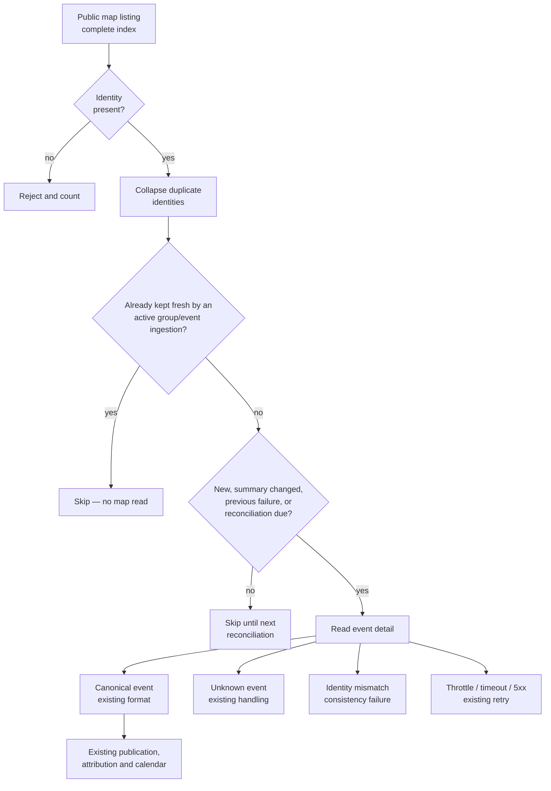

# Feature Specification: Map Event Discovery and Detail Resolution

**Feature Branch**: `006-map-event-discovery`

**Created**: 2026-10-30

**Status**: Draft

**Input**: User description: "Ajouter au action populaire client 2 capacités — Récupérer depuis https://actionpopulaire.fr/carte/liste_evenements/ — Et ensuite récupérer depuis https://actionpopulaire.fr/api/evenements/0b75e623-33b2-4e4e-8e73-add257957513/details/ — Définir et s'assurer des formats avant mise en place. ça doit être compatible avec l'existant. En cas de question sur l'implémentation me les poser."

## Why This Feature Exists

Today the calendar learns about an event only when a listing of a group it already tracks returns that event. An event organized by a group outside the tracked catalogue, or an event that no tracked group listing happens to return, stays invisible or goes stale. Coverage is therefore a side effect of which groups are known, not of what the source actually publishes.

The source publishes a public map listing: one response that enumerates every publicly mapped event with its identity, name, start and end times, coordinates and subtype. It is a complete index of the map, independent of any organizer catalogue. The source also publishes a per-event detail document that carries the authoritative content, location, organizer attribution, description and subtype of one event.

The feature adds both reads to the Action Populaire client so a discovered map event can be resolved to the same canonical event representation the calendar already publishes. The formats are deliberately different: the map listing is a compact index, while the detail document already matches the existing canonical event contract. Only a detail document may produce calendar content. The map listing is an index and a change hint, never a substitute. Keeping that boundary is the compatibility guarantee of this feature.

The map listing complements the existing ingestion rather than replacing it: it fills the gaps that group and event ingestions leave, and it does not re-read events those ingestions already keep fresh.

## Clarifications

### Session 2026-10-30

- Q: Which events does the map listing make eligible for discovery? → A: Gap-filling. A listed identity is resolved only when no active group or event ingestion is already responsible for a fresh observation of it, or when its last observation is absent or older than the configured freshness horizon. Existing group and event ingestions keep refreshing the events they cover.
- Q: When is a detail document read for a discovered event? → A: For gap candidates, a detail read happens when the identity has no canonical observation, when the summary changed since the last map observation (name, start, end, coordinates or subtype), when the previous detail attempt failed, or when the periodic reconciliation interval elapsed. An unchanged, already-resolved identity is not re-read before that interval.
- Q: What happens when one entry of the map listing is malformed? → A: Identity is mandatory. An entry without a non-empty identity is rejected and counted without blocking the rest of the snapshot. Invalid optional hints (times, coordinates, subtype, display date, link) are dropped and counted, but the entry remains discoverable by its identity because the detail document is authoritative.

## Discovery Flow

Every branch increments an observable counter. The map summary never crosses the publication boundary on its own: it selects identities, while the detail document supplies everything that is published.

## User Scenarios & Testing _(mandatory)_

### User Story 1 - Discover events from the public map (Priority: P1)

As a calendar operator, I want the client to read the public map listing so that events no currently tracked group listing exposes can be discovered.

**Why this priority**: Discovery is the missing input. Without it, the detail capability only serves events the calendar already knows, and the coverage gap this feature exists for remains.

**Independent Test**: Serve a map listing fixture containing several valid summaries, read it with the client, and verify that every stable identity is returned with its times, coordinates and subtype, and that no canonical event content is produced from the summary alone.

**Acceptance Scenarios**:

1. **Given** a valid map listing response, **When** the client reads it, **Then** it yields one summary per entry carrying a non-empty identity, name, start and end times with explicit offsets, coordinates and subtype identifier.
2. **Given** a response that is not a JSON array, **When** the client reads it, **Then** it reports a source-format failure and never yields a partial list.
3. **Given** a listing that contains the same identity twice, **When** the client reads it, **Then** that identity appears once and the duplicate is reported as a data-quality event.
4. **Given** an entry with a valid identity and a malformed optional hint, **When** the client reads the listing, **Then** the identity is still discoverable, the invalid hint is dropped and counted, and the rest of the snapshot is unaffected.
5. **Given** pagination-style query parameters, **When** the client reads the listing, **Then** the response remains the complete listing; the source exposes no page semantics.

---

### User Story 2 - Resolve a discovered event to its authoritative detail (Priority: P1)

As a calendar subscriber, I want a discovered event to show the same accurate content, place, times, subtype and organizers as any other event in the calendar.

**Why this priority**: A discovered identity without authoritative content is not publishable. Detail resolution is what turns discovery into a correct calendar entry.

**Independent Test**: Take an identity from a listing fixture, serve a matching detail document, and verify the client returns a canonical event whose content comes exclusively from that detail document; then serve a 404 and an identity mismatch and verify the existing classifications.

**Acceptance Scenarios**:

1. **Given** a listed identity and a matching detail document, **When** the client resolves it, **Then** it returns a canonical event built from the detail's start and end times, timezone, location, groups, subtype and description.
2. **Given** a detail document that describes another identity, **When** the client resolves it, **Then** the inconsistency is reported and no event is published.
3. **Given** a detail resource that answers "unknown event", **When** the client resolves it, **Then** the outcome is the existing unknown-event classification, not a cancellation or a deletion.
4. **Given** a throttle, timeout, connection failure or server error, **When** the client resolves a detail, **Then** the existing retry and failure classifications apply unchanged.

---

### User Story 3 - Keep detail reads bounded and observable (Priority: P2)

As an operator, I want the number of detail reads and the fate of every listed summary to be visible and bounded, so a large public map cannot overload the source or the worker.

**Why this priority**: The public listing can contain thousands of events. Reading every detail on every cycle would multiply upstream load and replace a coverage problem with an availability problem.

**Independent Test**: Serve a listing mixing already-observed and newly discovered identities, apply the refresh policy, and verify only the selected identities trigger a detail read while every summary receives an explicit outcome.

**Acceptance Scenarios**:

1. **Given** an identity already kept fresh by an active group or event ingestion, **When** the cycle runs, **Then** it is not a gap candidate and no map-initiated detail read occurs for it.
2. **Given** an unchanged gap candidate resolved during the previous reconciliation interval, **When** the cycle runs, **Then** it is not re-read before the interval elapses.
3. **Given** a cycle, **When** it completes, **Then** the number of listing entries read, gap candidates, selected identities, skipped identities, rejected entries, and resolved, unknown, mismatched and failed detail attempts are each observable through the map counters.
4. **Given** one detail read failing, **When** the remaining summaries are processed, **Then** the failure does not abort the other reads.

---

### User Story 4 - Preserve existing calendar behaviour (Priority: P2)

As a subscriber, I want the new source to add coverage without changing what I already see until a detail document confirms it.

**Why this priority**: Compatibility is an explicit requirement. A discovery source that rewrites, duplicates or removes existing events would be a regression, not an improvement.

**Independent Test**: Run the existing group ingestion scenarios alongside a map listing that repeats, misses and reshapes events, and verify the published calendar is unchanged except for genuinely new or confirmed events.

**Acceptance Scenarios**:

1. **Given** existing group ingestion and attribution, **When** map discovery runs, **Then** the existing group behaviour and attributions are unchanged.
2. **Given** a map summary whose name, times or coordinates differ from an existing canonical event, **When** no detail document confirms the change, **Then** the published canonical event is unchanged.
3. **Given** an event that disappears from the map listing, **When** the cycle completes, **Then** the event is neither cancelled nor removed on that evidence alone.
4. **Given** the same identity observed through group ingestion and map discovery, **When** both complete, **Then** the calendar contains one event for that identity.

### Edge Cases

- The map listing is a valid empty array: it is a complete snapshot with no event, not a retrieval failure.
- The map listing is very large (thousands of entries): memory stays bounded to the index plus one detail document at a time.
- An entry has a missing or blank identity: it cannot be discovered, is rejected and counted, and does not block the rest of the snapshot.
- An entry has a valid identity but an unparsable start or end time, an end before its start, or invalid coordinates: the identity remains discoverable, the invalid hints are dropped and counted, and the detail document supplies the truth.
- Coordinates are absent or null, as can happen for an online event: the entry may still be discovered because coordinates are not authoritative content.
- The subtype identifier is unknown to the calendar: it is kept as an identifier only; the detail document supplies the label.
- The human-readable date text is in French and differs from the machine times: it is presentation only and must never be parsed.
- The listing shows an event that the detail resource no longer returns: the outcome is the existing unknown-event classification.
- The listing and the detail document disagree on start or end time: the detail document wins; the discrepancy is observable.
- The detail document states no organizer group: this is the existing "no group stated" case, not an attribution to the listing.
- The detail document lists attendee groups but no organizer group: attendees are not organizers and must not become attribution.
- The upstream answer is a cached listing up to five minutes old: discovery tolerates it and never treats age alone as a failure.
- The upstream returns an HTML error page or invalid JSON with a success status: it is a source-format failure.

## Requirements _(mandatory)_

### Functional Requirements

- **FR-001**: The client MUST expose a read of the public map listing that returns the complete set of publicly mapped event summaries.
- **FR-002**: The map listing read MUST accept only a JSON array and MUST validate each entry's identity. Invalid optional hints follow FR-015.
- **FR-003**: The summary contract MUST cover identity, name, start and end times with explicit offsets, coordinates, subtype identifier, display date and public link, and MUST tolerate unknown extra fields.
- **FR-004**: The summary contract MUST remain distinct from the canonical event contract; a summary MUST NOT be treated as a canonical event or published as one.
- **FR-005**: Every summary MUST carry a stable, non-empty identity, and a listing MUST collapse repeated identities to one.
- **FR-006**: The client MUST expose a read of one event's detail document that returns the existing canonical event representation, including the extra presentation fields being ignored.
- **FR-007**: A detail document MUST describe the requested identity; a different identity MUST keep the existing retryable consistency classification (`EventIdentityMismatchError`), so a stale cache or proxy cannot stall refresh permanently.
- **FR-008**: An unknown event answer on the detail read MUST keep the existing unknown-event classification and MUST NOT be interpreted as a cancellation.
- **FR-009**: Throttle, timeout, connection failure, server error and client-error handling for both reads MUST keep the existing retry and failure classifications.
- **FR-010**: The map listing MUST be used only for discovery and change hints and MUST NOT overwrite any canonical field.
- **FR-011**: Only a detail document MAY supply canonical content, timezone, location, organizer attribution, subtype label and description. The canonical event format MUST remain unchanged.
- **FR-012**: An event absent from the map listing MUST NOT be cancelled, deleted or retired on that evidence alone; only a complete detail observation, an ended event or an unknown-event answer may change its life cycle under existing rules.
- **FR-013**: The feature MUST read a detail document only for gap candidates, meaning listed identities for which no active group or event ingestion is already responsible for a fresh observation, or whose last observation is absent or older than the configured freshness horizon.
- **FR-014**: Among gap candidates, a detail read MUST occur when the identity has no canonical observation, when the summary changed since the last map observation (name, start, end, coordinates or subtype), when the previous detail attempt failed or was rejected as another identity, or when the periodic reconciliation interval elapsed; an unchanged resolved identity MUST NOT be re-read before that interval.
- **FR-015**: An entry without a non-empty identity MUST be rejected and counted without blocking the rest of the snapshot. Invalid optional hints MUST be dropped individually and counted, while the entry remains discoverable by its identity.
- **FR-016**: The feature MUST NOT duplicate work already performed by an active ingestion scope for the same identity in the same cycle.
- **FR-017**: Every listing entry and every detail attempt requested by map discovery MUST produce an observable outcome: read, gap candidate, selected, skipped, rejected, resolved, unknown, mismatched or failed. Detail attempts of event scopes discovered through group listings keep their existing counters and are out of scope for the map counters.
- **FR-018**: Existing group catalogue, group event retrieval, attribution and publication behaviour MUST remain unchanged.
- **FR-019**: The feature MUST NOT introduce a second persisted event representation; both sources converge on the existing canonical event.

### Source Formats and Compatibility

#### Public map listing

Observed response: a bare JSON array (about 2,700 entries at the time of specification, roughly 1 MB), served with a five-minute public cache. Pagination parameters do not change the result. Entries are not guaranteed to be ordered.

| Field         | Shape                                                                          | Use in this feature                            |
| ------------- | ------------------------------------------------------------------------------ | ---------------------------------------------- |
| `id`          | Non-empty string, stable event identity — **mandatory**                        | Discovery identity and detail lookup key       |
| `name`        | Non-empty string                                                               | Optional hint; change detection only           |
| `coordinates` | GeoJSON `Point` with `[longitude, latitude]`, or null                          | Optional hint; change detection only           |
| `date`        | French human-readable text such as "le 23 octobre 2027 à 16:00 (Europe/Paris)" | Optional hint; presentation only, never parsed |
| `link`        | Absolute public event URL                                                      | Optional hint; provenance only                 |
| `start_time`  | ISO 8601 timestamp with explicit offset                                        | Optional hint; change detection only           |
| `end_time`    | ISO 8601 timestamp with explicit offset                                        | Optional hint; change detection only           |
| `subtype`     | Integer subtype identifier                                                     | Optional hint; change detection only           |

An invalid optional hint is dropped and counted, but never invalidates the identity: the detail document is authoritative for every published value.

The listing carries no timezone field, no address, no description and no organizer list. Those fields can only come from the detail document.

#### Event detail document

Observed response: a single JSON object already accepted by the existing canonical event contract. It adds presentation fields (description, illustration, routes, RSVP state, attendee groups, calendars) that the existing contract ignores. The organizer attribution is the `groups` collection; `groupsAttendees` is not an organizer list and MUST NOT be used as one. The `groups` collection may be empty even when many groups attend.

#### Compatibility rules

- The canonical event format is unchanged; no new event shape is persisted.
- The summary's snake_case times and integer subtype MUST NOT be mapped to canonical fields; only the detail document supplies them.
- Timezone for a canonical event comes only from the detail document.
- A detail identity mismatch keeps the existing retryable consistency classification; an unknown event keeps the existing non-retryable unknown-event outcome.
- The existing client timeout, throttle retry and error classification apply to both reads.
- A listing or detail failure MUST NOT erase or cancel an existing event.

### Key Entities

- **Map event summary**: the minimal discovery record — stable identity, name, start and end times with offsets, coordinates, subtype identifier, display date and public link. It is an index, not a calendar event.
- **Event detail observation**: the authoritative record of one event in the existing canonical form — times, timezone, location, organizer groups, description and subtype label.
- **Discovery selection**: the gap-filling rule that decides whether a summary is a candidate and, among candidates, whether it needs a detail read because it is new, changed, previously failed or due for reconciliation.
- **Upstream read outcome**: the classification of each listing entry or detail attempt (read, gap candidate, selected, skipped, rejected, resolved, unknown, mismatched, retryable failure, non-retryable failure).

## Success Criteria _(mandatory)_

### Measurable Outcomes

- **SC-001**: 100% of valid entries in a map listing sample are represented by a stable identity in the discovery result.
- **SC-002**: Zero calendar events are produced from a map summary alone; every published event resolved through this feature matches its detail document.
- **SC-003**: 100% of existing group ingestions, attribution and calendar behaviours continue to pass unchanged after the feature is enabled.
- **SC-004**: A map listing of at least 3,000 events is processed with memory bounded to the listing plus at most one batch of observations; detail reads, when they occur, hold at most one detail document at a time.
- **SC-005**: Every rejected entry and every unknown, mismatched or failed detail attempt is counted; no entry disappears silently.
- **SC-006**: Detail reads per cycle never exceed the existing per-cycle promotion ceiling (`maxNewGroupsPerCycle`), and a single detail failure never stops the rest of the cycle.
- **SC-007**: Zero published events are removed or cancelled solely because they were absent from a listing.

## Assumptions

- The public map listing needs no authentication; the client keeps sending its configured token when one exists, without making it mandatory.
- The listing is a complete snapshot of publicly mapped events at response time, tolerating an upstream cache of up to five minutes.
- The listing exposes no pagination; a single response is the whole index.
- The detail resource needs no authentication and is the same resource already used for events without a stated group.
- Machine times in the summary are authoritative only for detecting change; the detail document is authoritative for content.
- The existing timeout, retry, throttle and error classes are reused for both reads without new configuration.
- The existing per-cycle ceiling and scheduling framework bound the feature; no new scheduling mechanism is introduced.
- Gap candidates are determined from the existing observation and scope state; the feature introduces no second event inventory.
- The freshness horizon, reconciliation interval and per-cycle ceiling are configuration values with safe defaults chosen during planning.
- Operators remain responsible for the refresh cadence and the per-cycle volume.
